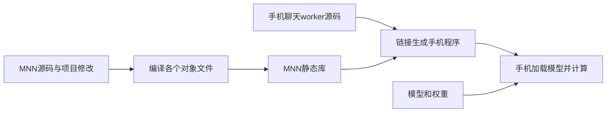

# 从源码到手机程序：这次要补齐哪一段

你已经看到手机能回答问题。现在要能回答另一个问题：如果不使用我们过去编好的MNN库，能不能根据明确的源码和配置重新生成它？本课只要求理解“谁生成谁”，不用记每条构建命令。

## 先分清两个入口

`phone_chat.py`在电脑上收问题、维护消息、通过ADB连接手机。手机上的`phone_chat_plan_worker.cpp`接收请求、调用MNN的LLM接口并把生成结果返回。真正的LLM流程、Module执行和CPU算子实现位于MNN源码中，先被编译成框架静态库，再链接进手机程序。

## 重新链接与重新编译有什么区别

假设只修改worker里的一句日志，那么重新编译worker并链接已有MNN库即可。框架内部算法没有改变，无需重编所有算子。

如果修改的是MNN的LLM流程或CPU Attention，那么只换worker源码不够：修改必须进入对应对象文件，再进入框架库，最后进入手机程序。否则你可能在阅读新源码，手机运行的却仍是旧实现。

本项目早期实验曾只重编几个改变的对象，再替换旧库的成员。这适合快速实验，但它依赖旧库的其余部分。现在要在空构建目录里把全部框架对象重新编译，验证源码与配置本身足以生成可运行程序。

## 为什么还要固定配置

同一份源码可以生成不同能力的库：CPU还是GPU、是否带量化算子、是否支持LLM、是否启用某类ARM内核。这些选择影响参与编译的代码。因而“源码版本相同”只是一个条件，还需要记录编译器、目标架构和算子依赖。

你只需要理解这些配置决定“这次程序里装进了哪些实现”。具体选项列表放在工程锁定文件，不当作背诵内容。

## 怎样判断这一阶段完成

第一层是构建证据：源码修改完整，使用新的源码和空编译目录，没有拿旧静态库或旧对象来补。第二层是运行证据：新库链接出的手机程序能按同样输入执行，回答与状态能对上，并正常退出。

不能只看到“编译成功”便宣布正确，也不能要求两份可执行文件的每个字节都一样。编译路径、工具与调试信息可能改变文件字节；计算正确性要由相应测试判断。短回答一致也不等于完整logits或所有模型都已验收。

本阶段当前状态：新源码树已完整编译成CPU框架库，再链接手机worker；对象与归档成员、执行来源和系统依赖均经独立核验。固定手机上的三组新旧请求对照通过：输入/输出token、文字、状态和执行路径一致，进程正常退出。工程已完成本轮范围，课程已提供，理解待反馈。

## 源码只看三个位置

- [专用构建脚本](../scripts/android/build_mnn_source.py)：`prepare`决定输入源码与配置，`build`执行编译和链接。它不会处理用户提问。
- [手机worker](../apps/android/phone_chat_plan_worker.cpp)：接收请求并调用LLM，是真正运行在手机上的入口。
- [固定配方说明](../configs/android/mnn-source-build/README.md)：说明框架源码与补丁的来源，以及如何从明确输入重建。

框架计算仍沿固定MNN版本的`transformers/llm/engine/src/llm.cpp`、`express/module/StaticModule.cpp`到`source/backend/cpu/CPUAttention.cpp`等实现。这些在本次会全部重新编译；不需要为了理解本课一次打开所有文件。

## 这次希望你真正记住的结果

现在有证据说明：项目修改进入了MNN框架对象，全部框架对象组成了新库，新库进入了手机程序，手机程序实际回答了问题。构建说明已不必依赖过去留下的旧对象或旧静态库。

这项结果把“源码看起来改了”连接到“手机确实运行了这个构建”。它没有证明所有模型的每个logit都一致，也没有测新速度；当前只验收本机工具链、固定CPU配置和固定手机的生成回归。原聊天入口仍用此前已验运行包；新构建目前是经验证的显式实验候选，下一步再接入可选运行包导出。

本轮中途的编译临时目录与路径替换错误已修复，原失败保留在工程记录。你不需要把这些适配细节当成必背原理。公开精简验收见[构建与实机证据](https://github.com/kerry0520/edge-inference-framework/tree/main/evidence/clean-source-build-20261015)。
