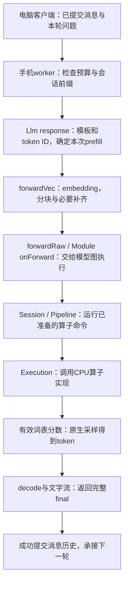

# 端侧推理框架：交付与复现指南

本项目基于固定MNN 3.6.1提交 `d407447ed56c4121a11ccbd266dc184ca1ead0c2`，在Mi11 ARM64 CPU上运行Qwen3-0.6B量化模型，提供电脑驱动的手机常驻流式聊天与可选固定32块KV复用。源码改动、运行入口和实机证据组成交付；框架底座、模型和工具链仍是外部依赖。运行入口不是Android图形App。

## 一次请求怎样走进模型

可以从一个具体问题开始：用户问“2+10等于几”。Python客户端把已提交消息与本轮问题发给手机worker。Worker先检查部署预算；请求被接受后才调用MNN的LLM入口。



你学过的prefill/decode在这里由LLM层组织；MNN模型图执行负责把这次forward中的张量运算跑完。Backend用于选择和创建硬件算子实现、管理相应资源；Pipeline运行这些已经准备好的Execution命令。因此Backend不适合被画成每次运行中单独排在Pipeline之后的一步。

三个容易混淆的对象分别属于不同层：消息历史属于聊天应用；token序列和可保留KV位置属于LLM执行组织；具体张量及算子命令属于模型图和硬件后端。缓存优化要让这三层对应同一段已经计算的序列。完整分数正确性、自然任务质量和请求时间各自验收，不能互相代替。

真实入口可从以下源码定位。LLM使用本项目已保存的受验库源码快照，核心调度引用固定MNN公共源码；上游框架其余源码由外部固定checkout提供。

| 职责 | 当前源码入口 |
|---|---|
| 客户端与完整消息提交 | `scripts/android/phone_chat.py`、`phone_chat_session.py`、`phone_chat_kv_session.py` |
| 手机预算、流式返回与历史提交 | `apps/android/phone_chat_worker.cpp`、`phone_chat_kv_worker.cpp` |
| token输入、guard与分块 | `results/android/block-policy-20261011/llm-source-reference.cpp` 的 `response` / `forwardVec` |
| 模型图接口 | 同快照 `forwardRaw` 调用 `Module::onForward`；MNN `express/module/StaticModule.cpp` |
| 执行调度 | MNN `source/core/Session.cpp` 的 `run`、`Pipeline.cpp` 的 `execute` |
| 算子实现 | `Backend::onCreate`创建Execution，Pipeline调用其`onExecute` |

## 怎样运行和怎样验证

在本项目已配置并配对的环境中，运行入口是：

```powershell
python scripts/android/phone_chat.py
python scripts/android/phone_chat.py --mode kv
```

第一条默认完整历史重算；第二条选择固定32块KV模式。输入 `/history` 查看已提交历史，`/new` 等待手机确认清空，`/exit` 正常关闭。模型计算在手机进行，电脑负责输入、显示和记录。新电脑运行前需要准备匹配的Python、ADB、手机配对、固定模型和worker构建产物，不能只拿源码审阅ZIP就运行模型。

新版审阅包的验证入口为：

```powershell
python scripts/verify_android_delivery_v2.py --root 解压目录
```

它只需Python标准库，重新核对包内原始退出、自然输出、有效词表分数、冻结任务规则与性能统计。它不连接手机，不重建MNN，也不生成新回答。包内 `legacy/` 保持旧交付源码及历史证据的原始字节；外层放当前源码和后续验证。外层新客户端必须有自己的新实机记录，旧包的通过不能替代它。

## 目前能支持的结论

固定CPU、同步greedy普通AR、无shape limits的32块路径，在已冻结场景中保持同配置完整计算/复用分数一致。有效limits测试观察到真实padding、正确有效采样行及keep0回退。自然聊天已验证EOS/MAX后继续、拒绝不提交、new清空与退出；它不证明每一道自然语言任务都完成正确。

长背景短输出场景的同chunk32完整response续轮时间减少约56%/71%。默认chunk0与chunk32不是数值等价结论，这些速度数字也不代表所有输入、设备或线程配置的统一收益。更改配置时应先确认是否属于受验范围。

本指南供看懂项目和找入口；具体原始证据见[交付索引](端侧推理项目交付索引.md)，学习正文统一追加[连续复习](端侧推理框架连续复习.md)。新版包的最终生成与独立验收状态，以当轮交付报告和逐文件manifest为准。

最终状态（2026-10-12）：[V2源码与实机证据包](../artifacts/android-review-v2-20261012-final.zip)已独立验收，公开`--root`和`--zip`均实际退出0。当前full/kv入口各一次手机请求正常完成，详见[最终交付报告](Android源码与实机证据最终交付-20261012.md)。冻结包内准备阶段文字保留原样，最终收据保存在包外。

2026-10-12 后续正式客户端已补[生成中断与退出收尾](Android生成中断与资源收尾-20261012.md)，当前工作树含新cleanup helper。中断会话保留未确认记录并结束，不能继续提问或自动重发；下一次启动新会话不会自动恢复旧对话。正常模式及`/exit`使用方式保持。旧V2 ZIP仍是前一阶段冻结快照，不包含本轮改动，本轮源和新实机证据另存Git与工程文档。

后续系统事件与真实受控连接断开也已完成[限定验收](Android系统CtrlC与传输中断验收-20261012.md)：正式CLI处理Windows Ctrl+C事件并清理自身资源，正式Session在真实TCP reset后保留历史/未知记录且拒绝续用。未测试实体按键或物理WiFi断网，模型/生产客户端字节本阶段未变。

2026-10-12 新增可选请求统计：运行`python scripts/android/phone_chat.py --stats`或`--stats --mode kv`，成功回答后显示token分工与原生阶段/客户端时间，`/stats`仅重显最近成功请求。范围及同chunk32结果见[请求统计说明](Android请求统计与KV阶段耗时-20261012.md)。旧V2ZIP不含新worker，新构建与36实机记录另存Git；旧默认入口继续可用。

当前客户端--stats同时显示首段非空文字等待与首段到final接收时间，见[首段计时说明](Android首段文字等待与流式计时-20261012.md)。74客户端测试与full/KV短长4新实机请求完成；数字不是原生token TTFT。旧ABBA24请求只读回算同配置首段收益另列，不把新功能验收当速度对照。

后续已完成[长输出多轮KV验收](Android长输出后的多轮KV验收-20261012.md)：同guard/chunk32完整重算与KV7组轨迹配对，14成功/2拒绝/2new。长MAX64后继续、拒绝保持历史和new冷起通过；不是默认full0等价性能声明，也不证明未触发的cap截断分支。生产入口保持，公开独立reader可只读核本轮原wire。

更新后的V3包整合当前统计和多轮源码及54正式历史请求的证据。使用方式先看[快速开始](Android项目快速开始.md)，包范围见[V3说明](Android源码证据交付包V3说明-20261012.md)。旧V2保持冻结，只是历史资料；V3的最终ZIP SHA与最后实际验收在包外交付收据保存。

2026-10-13 当前源码新增--stats-build-tag选择新的已验证worker，见[构建选择说明](Android统计worker构建选择-20261013.md)。默认v2不变；新选择有本轮4正式手机请求与87测试。V3ZIP保持旧冻结字节，不含此后续功能，相关源与原件单独保存在Git。

2026-10-13新增独立[真实算子执行观察](Android真实算子执行观察-20261013.md)，用于把Module/Session/Pipeline/Execution与实际Q投影张量形状接起来。公开callback模式4真实请求2配对通过，仍是诊断实验，不改变正式chat/buildtag或MNN库，不是新的生产性能结果。旧V3ZIP不含这轮新观察工具，原件另存Git。

2026-10-13新增[Q投影与CPU量化派发](AndroidQ投影与CPU量化派发-20261013.md)，以只读图metadata确认Q的W4和词表层W8，再按public source讲Creator/Execution/kernel条件。0模型forward/不改原生产文件，不能把图bits或前一回调当具体指令实测；旧V3ZIP保持原样。
