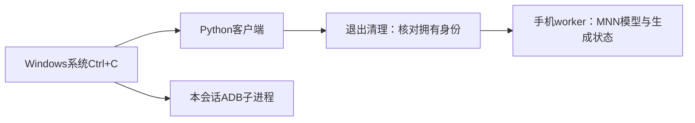

# 端侧推理框架连续复习

这份文件从上次工作接着写，后续几轮也会更新在这里。你只需要打开这一个入口；详细源码、日志和数值证据用链接保留。本页记录“希望你理解什么”，不将工程通过当作你已经掌握。

## 这段工作在项目主线上的位置

电脑发出聊天请求 → 手机进程保留模型与对话 → 文字变成token → 决定重算完整历史还是复用KV → MNN执行模型 → Attention及量化算子完成计算 → 采样并返回文字。

当前集中处理的是中间两步的交接：**复用哪些已计算的历史，以及新增位置怎样执行低精度Attention**。它会决定多轮聊天能否既省去重复计算，又保持可验证的结果。最终要把通过验证的实现接回可用的聊天入口，而不是只留下一组实验。

现有入口默认完整历史重算，可选固定32分块KV复用。2026-10-11新增独立可选的增量KV候选入口，已完成下面的本机验收。MNN缓存修复PR属于权重资源生命周期，已单独提交，不等于此处的KV优化。

## 上次：为什么保存了正确KV，结果仍可能不同？（2026-10-08）

你熟悉nano-vLLM的KV基本机制，这里只补一个端侧低精度细节。完整重算处理47个位置，保留前22个位置的KV后，只算新增25个。同一个新增位置的原始Q和可见K/V可以相同，结果却仍不同。

原因在Attention执行器的计算准备：为了降低FP16溢出风险，原路径先缩小Q，再在QK分数上补偿。它用整批Q的最大幅值决定系数；47行和25行的极值可能不同，相同Q也会被乘上不同系数。FP16缩小过程中已经发生舍入，补偿不能找回丢掉的信息。

候选让每个`(Query, head)`按自身幅值选系数，并给这一行的QK分数传对应补偿。位置在这条链中：

**投影产生Q/K/V → Attention执行器准备系数和打包输入 → 内核计算QK → 补偿分数 → softmax/PV → 后续层与词表分数。**

我们改的是执行器怎样准备参数，未重写注意力公式、矩阵乘内核或W4权重。启用范围限定为ARM64、FP16、Flash、未量化K/V等条件，其他路径保留原实现。

上次工程结果：去掉内部诊断hook后，原案例真实47/25复用、长背景自然三轮和高精度原路径回归均通过；完整词表分数与自然输出按各自对照一致。真实Attention的46个边界用例也通过。默认聊天入口未改，尚无完整性能对照。[工程验收](Android逐Query无诊断生产验收-20261008.md)

你应能解释：为什么整批极值影响单行，系数与补偿由谁传给内核，为什么相同答案不能替代完整分数检查。已讲解，理解待反馈。

## 上次还补了一个判断：开关开启不代表真的复用了

我们曾选到带“只保留完整32-token块”保护的库，配置使它退回全量重算。标为reuse的一边其实也算47个位置，两边一样不能证明复用正确。

因此验收要看实际处理长度：第二轮完整长度47、实际新增25，才说明保留了22。配置表达希望做什么，运行证据说明真正做了什么。这也是后续接回聊天入口必须检查的交接。

## 本轮：怎样判断省去计算是否减少响应时间？（2026-10-11）

正确性验收会导出完整词表分数，带来额外复制和写文件成本。测性能时使用另一个没有这些观测动作的worker，仅包围真正的`response()`请求；模型加载、额外记录和电脑到手机的无线传输在计时窗口外。框架在response内部进行的模板处理、分词、prefill、decode和采样则计入。

两边都在一个已加载模型里完成同样的自然多轮：一边每轮重算完整历史，另一边复用KV。实际输入、输出token和停止状态仍需一致，否则后面已经不是同一个任务。正反顺序重复用于减轻时间趋势影响，不能消除手机发热或后台任务。

这里测的是**同一候选下KV复用是否节省完整请求时间**，不是逐行缩放这段代码自身跑快了多少。复用减少prefill位置，decode、采样和其它必要工作仍存在；所以少算80%的输入位置，不自动等于整个请求快80%。

这次已完成8个模型进程、24次请求，两种模式各重复4次。长背景三轮的请求时间中位数如下，实际输入、自然输出和停止状态一致：

| 轮次 | 重算完整历史 | 复用KV | 怎样理解 |
|---|---:|---:|---|
| 第一轮 | 608毫秒 | 609毫秒 | 没有历史可省，基本相同 |
| 第二轮 | 623毫秒 | 173毫秒 | 完整143个位置，只算新增25个 |
| 第三轮 | 656毫秒 | 151毫秒 | 完整168个位置，只算新增29个 |

后两轮请求时间中位数减少约72%和77%。语料是长背景、短输出：第二轮生成4个token（含EOS），第三轮预算1个token。这限于本机、模型和这组场景；手机未锁频，也没有用它证明新缩放代码自身更快。减少部分prefill工作，让整个response更快，才是这张表支持的关系。[工程结果与原件](Android逐Query实机性能与采集-20261011.md)

后来的额外复测中断后，已只读恢复并确认原进程退出；部分数据保留，不加入这张完整对照表。采集可靠性属于证据工具，复习时不用背ADB细节。

你应能区分“内核耗时、模型执行耗时、完整请求等待”，并说明当前表格包围的具体范围。已讲解，理解待反馈。

## 本轮：把候选接回聊天，为什么还要检查会话？

Attention数值正确解决的是计算层问题；聊天还需要应用层维护消息和失败状态。新入口复用已有常驻C++ worker，把通过验证的库接入多轮和流式输出，没有另写一套模型服务。

这里最重要的是**只有成功的请求才能推进已提交的对话状态**。例如当前已有三轮成功历史，新问题超出token预算，应用应在推理前拒绝它。下一题仍基于原来三轮，而不是多出一个失败问题。`/new`则明确清空消息和请求状态，模型权重继续留在同一进程里。

要分清两个预算：生成预算决定这次最多回答多少token，达到它属于正常MAX结束，可以保留已生成的文字继续聊天；上下文部署预算限制“输入长度＋计划生成长度”，超出时在推理前拒绝。我们分别验证了这两种状态，不能把它们都叫错误。

实机已验证：原例第二轮保留22个位置；第三轮只生成一个token并正确以预算结束，后面仍可继续；超预算拒绝后历史不变，恢复预算可回答；`/new`后与最初同题的输入ID、输出token和文字一致。五个常驻请求分别对照五个独立冷进程，流式字节与最终文字相符。另有真实CLI两题试玩和正常退出。[会话验收证据](Android逐Query候选聊天实机验收-20261011.md)

这些是新worker的会话功能验收，不是又做了一次全部词表数值导出，也不是测了无线聊天的速度。前一阶段的完整分数验收与这一阶段的应用验收各自保留。

你应能解释：模型常驻、对话历史和KV是三个不同的状态；拒绝请求为何不应提交历史；新对话为何可以清状态而不用重新加载权重。已讲解，理解待反馈。

## 一个“分块”容易混淆的地方

现在第二轮可以保留22个token，不必凑成32的倍数。但内核仍会用自己的打包和分块方式计算。**逻辑上保留多少历史，与内核如何安排乘加，是不同职责。**

旧可选入口把保留范围限制为完整32-token prefill块，是执行策略的保护；新候选移除了已定位的缩放批次依赖，在当前条件下支持任意有效token前缀。其CPU Query打包和Flash对历史K/V的分块仍存在。配置chunk0只表示不在外层按固定prefill块拆输入，不表示内部每个乘法都逐元素执行。

## 现在怎样玩这套候选？

在项目目录、手机无线调试在线时运行：

```powershell
python scripts/android/phone_chat_query_session.py
```

可以先说“记住我的名字是小林”，再问名字；用`/history`看历史、`/new`新对话、`/exit`退出。原`phone_chat.py`入口继续保留，这个新命令是已在当前Mi11/Qwen3配置验收的可选方案。模型、配对信息和构建产物沿用本项目已有环境。

## 下一轮继续写在这里

下一步优先扩大真实会话的代表性条件、明确可选候选适用范围，再决定是否接入统一入口。当前不宣称所有模型/精度/后端均通过。Attention仍有临时数组分配和扫描成本，需要用数据决定优化优先级；不能因为看见vector就判断它是瓶颈。

后续几轮的目的、工程简要结果和需要理解的主线关系都会追加到本文件，详细过程继续链接工程记录。

## 继续推进：从一个成功例子到代表性会话（2026-10-11）

这一轮不重复前面的名字例子，改查算术条件更新、中英文字符串和事实更新。问题仍是同一个：完整重算与复用在相同真实token输入下，是否保持完整词表分数和自然生成路径。测试集换了内容，才能知道前面的限定结果覆盖到哪里；样例增加也不等于所有模型都通过。

新的统一入口正在准备`--mode query`，让你通过同一命令选择候选。路由只决定加载哪个会话模块，计算仍由手机上的同一MNN库完成。代表性数值核对和真实路由试玩通过后，才会把这个入口写成已交付。

还补一处资源契约：模型文件连续两次SHA相同，只能说明这段时间没变化；必须与受验版本的SHA比对，才能确认运行的确实是那一份模型。候选配置与验收绑定，这是让结果能用于交付的条件，而不是新增的注意力公式。

三类会话现已完成：算术条件更新、中英文字符串、事实更新。候选完整重算与复用的46份完整词表分数逐字节一致，输入ID、自然输出和结束状态也一致。首次掉线的采集原件保留，不计入通过；算术输出有预算截断，因此不把数值对照通过写成算术回答正确。[工程证据](Android逐Query候选代表性数值回归-20261011.md)

你应理解：增加真实输入样例是在扩大已验证的范围，不是用样例数量证明所有输入都正确。这里仍验证同一个候选内部的两条执行路径。理解状态未确认。

## 新发现：自己和自己一致，还需要和谁比较？

假设我们把原框架记作A，修改后记作B。`B完整重算 = B复用`回答的是“缓存复用是否额外改变结果”；`A完整重算`与`B完整重算`的对照回答的是“修改本身改变了什么”。前一组可以完全通过，后一组仍出现差异，因为B的两条路径可能一起采用了新的计算规则。

实际统一入口试玩“请记住我叫小明。”时，候选与原库的输出在第7个生成token开始不同；输入ID和预算相同。这不直接说明谁的答案更好，也不直接证明数值bug，但说明不能把候选内部一致当成保留原版行为的证据。固定候选历史再问名字，原版和候选都给出同一重复回答；它不是原版自己的自然多轮对话，也没有证明回忆成功。[对照与限制](Android统一聊天候选模式交付准备-20261011.md)

统一入口的路由和资源保护已准备、已试玩，但`query`继续保持实验候选身份。默认仍为完整重算。你不用背构建过程，需要会问：**这次比较的两边是谁，它能回答哪个问题？**

## 正在收窄修改：一个Query的head为何共用系数？

这里的Query是一个token位置在Attention中产生的Q；它有多个head，每个head包含一组数。原实现把这一批所有Query、所有head的数合起来求最大绝对值，决定统一缩小多少。旧候选拆得更细，每个`(Query, head)`各自决定。

但我们要解决的是“删去已缓存的Query后，剩余Query的缩放条件改变”。只要不同Query彼此独立，就能去掉这个依赖；并不需要让同一个Query的各个head也独立。因此新候选每个Query在全部head中求一个极值，各个head共用它的系数。

例如一个Query的两个head最大幅值分别为8和2：原版在单Query decode时统一乘`1/8`；旧候选分别乘`1/8`和`1/2`；新候选恢复统一乘`1/8`。再加入另一Query、最大幅值为16，原版会让前一个Query也改乘`1/16`，新候选仍让前一个乘`1/8`。**保留head之间原有的关系，同时隔离另一个Query的影响**，就是这次收窄修改的目的。

每个Query对应的QK分数仍用自己的系数补偿，随后才进入softmax。普通无padding、单Query decode的缩放选择应与原版一致；多Query prefill仍会改变原来的整批规则，所以不能承诺整个模型与原版的输出完全相同。新候选现已独立通过算子、三类完整模型冷启动/复用及高精度回退验证；结果与旧候选分开保存。

你应能说清：这次独立的单位是token位置；head仍是同一位置里的不同子空间。已说明，理解待反馈。

## 本次保存时的结论与下次入口

这次收窄修改已通过限定验收：普通单Query算子用例与原版一致；三类低精度会话的候选完整重算/复用分数一致，确实少算历史；高精度回退案例与原库一致。小明短预算续轮仍重复首答，不写成回忆成功。详细证据见[新候选验收](Android逐Query共享head缩放候选-20261011.md)。

你本轮只需抓住两个关系：**缓存复用要求剩余位置的计算条件不依赖被省去的其他位置；比较对象决定测试能证明什么。** 每个位置可以自己选缩放系数，同时保留该位置各head共用系数的原有规则。算子对照、完整模型对照、答案质量是三个不同的判断。

目前可试玩入口仍链接之前的v2实验候选，新的v3只在隔离验收中运行；默认完整重算不变。下次先核对v3相对原版在完整prefill中的影响，再决定是否更新候选聊天资产并重做生命周期验收。此前v2性能数字不能直接用于v3。用户要求先保存，本轮不继续启动新实验；课程已整理，理解仍待反馈。

## 继续：为什么生成分岔后不能直接比较分数？

prefill把同一整段输入变成第一步词表分数，我们可以对原版和候选逐项比较。随后decode每步会把选出的token接回输入。如果原版选择A、候选选择B，下一步两边读到的文字已经不同，此时分数不同既可能来自实现，也可能来自不同输入，不能直接归因。

所以本轮首先比较相同完整输入的第一步：151,936个候选分数是否有限、变化多大、最大分数对应token是否改变。还看第一名与第二名之间的差距；小数值变化遇到很小差距就可能改变贪心选择。若后续要继续对照实现，必须让两边读到同一固定token轨迹，并标清那是受控对照，不是自然生成回答。

这一步连接“模型输出分数→采样选择→下一步输入”。它帮助判断候选对原有行为的影响，不能单凭有限性或误差小就宣布答案质量保持。当前手机离线、工具准备中，本轮尚无新实机结论。

本轮对照已完成：相同输入下，原版与v3的完整词表分数确实有差异，小林第二问的首步选择也改变。它不是“小误差”的既定结论。小明与混合语言的自然token相同，也不代表它们的分数相同。因此暂不把v3接入统一聊天入口。[原版影响证据](Android逐Query原版prefill影响对照-20261011.md)

现在增加高精度参考：冻结原来真正运行的完整token IDs，让参考路径读完全相同的输入。它能帮助判断两种低精度计算离高精度路径各有多远，但高精度路径仍使用同一量化模型权重，不是原始训练模型的标准答案，更不能自动代表语义质量。先验证“显式ID入口”和原聊天入口对同一ID产生相同低精度首步分数，再使用这个入口比较精度，避免把换入口的影响混进精度变化。

这一轮同时准备了独立v3聊天资产，但只是离线编译和协议保护检查；目前还没有新资产的手机会话验收。默认、v2候选及已保存记录均保留。

高精度参考现已完成：四份冻结ID的低精度回放完全重现原入口的首步分数，因此比较前提成立。小林第二问的新候选首token与高精度参考相同，但整份分数误差没有全面优于原版；另外三个输入也不是所有指标一致改善。我们只能说复用一致性得到验证，不能据此宣称候选质量提升。[高精度参照](Android逐Query高精度参照-20261011.md)

这里还要分清“选中的token相同”和“分数向量接近”。贪心采样只取最高分，其他151,935个分数怎样变化不会直接显示在这一个token上。反过来，第一名和第二名很接近时，分数变化就能交换它们的顺序；本例原版第二问的两名差距约0.03。输出token是一种离散选择，它不能概括全部数值误差。

固定版本的真实入口是 [文字消息response](C:/Users/32065/Documents/ChatGPT/端侧推理框架/build/mnn-android-source/transformers/llm/engine/src/llm.cpp:1104)、[token ID response](C:/Users/32065/Documents/ChatGPT/端侧推理框架/build/mnn-android-source/transformers/llm/engine/src/llm.cpp:1074) 与 [sample](C:/Users/32065/Documents/ChatGPT/端侧推理框架/build/mnn-android-source/transformers/llm/engine/src/llm.cpp:786)。它们分别承接文字输入、接收已经编码的输入、把模型分数变成下一token；实验用第二个入口冻结输入，用第三个入口观察分数，并没有重写模型计算。

现在只在隔离候选目录继续会话验收。模型执行结果与会话是否正确提交、清空、退出是不同职责，应用层通过也不能抵消上面的数值和质量限制。理解仍待反馈。

## 本轮收束：候选可运行，与可以推广是两件事

隔离候选现已通过真实会话验收：同一模型进程的五次请求分别与五次冷启动对照一致；续轮确实只算新增位置；生成预算结束后可继续，超上下文拒绝不提交历史，清空后与最初同题相同，流式和退出也正常。另有真实CLI两题成功。[聊天验收](Android逐Query共享head缩放聊天隔离准备-20261011.md)

这些结果回答应用层是否正确承接候选。完整prefill相对原版的分数变化与质量影响，仍由前面的数值对照和后续质量验收负责。我们没有把聊天能回答两题当成质量通过，也没有用上轮v2的速度数字代表v3。下一步需要明确覆盖的输入与质量标准，再决定是否推广这个低精度策略；通用兼容、质量保持与v3性能仍未验证。

想单独试玩已验收的隔离候选，可以在项目目录运行：

```powershell
python scripts/android/phone_chat_query_v3_session.py
```

它需要当前受验手机、模型和本机构建资产，自动寻找已配对连接。已有统一入口仍使用原来的模式。此命令只指向独立v3实验资产，默认聊天没有升级。本轮内容已讲解并保存，理解待反馈。

## 长任务：用任务答案检查候选的影响

前面的完整分数对照说明计算改变了，但不能回答“用户任务做得怎样”。这一轮先写出固定问题、可人工推导的参考答案和评分规则，再让三条路径读相同输入：原低精度、候选低精度、原高精度参考。

答案是否正确、是否正常EOS结束、推理进程是否成功是不同判断。比如程序退出0却答错算术，是任务失败；生成预算截断是正常MAX结束，却不一定完成了答案；回答对了一个名字，也不代表其余词表分数保持原样。我们把这些状态分别保存，再比较同一题在不同路径上的得失。

这是一组受控功能回归，不是标准综合benchmark。固定助手历史题检验“读取同一历史能否答对”，不是自由多轮生成验证；高精度也会按同一人工答案评分，不作为标准答案来源。先冻结规则，才能避免看到输出后放宽规则或换题，让候选看起来通过。当前正在准备和独立审查，尚无本轮质量结果。

## 质量结果：总分相同为什么还不能说没有退化？

这批24题的严格通过数，原低精度与候选都是5，高精度参考为6。它衡量“按照要求输出并正常结束”，不是通用模型准确率。比如有些算术题给出了正确计算，却附加解释，违反了题目只输出整数的要求；不能把这种严格失败统称为算术不会。

重要的是逐题关系：原低精度和高精度会按要求返回裸JSON，候选在同一题外面加上Markdown代码围栏，因此这题退化了；另一题问当前批次，原低精度和高精度答了已取消的R2，候选答对新的T8，因此这题改善了。改善一题、退化一题能让总分不变，却不代表用户原来能成功的任务都被保留。

所以我们采用运行前写好的规则：原版能完成、候选不能完成的任务要保留为退化，阻止替换当前默认。没有在看到答案后去掉JSON围栏、改评分或换题凑通过。高精度同样会答错旧值，它仍然只是参考路径。

另外四题在全新进程中重跑，输入、token、文字和状态与批内reset相同。这是在核验采集器的会话隔离，不是新增题目或用重复次数证明质量。[冻结方案](Android质量回归方案-20261011.md)与[原件/评分](Android逐Query候选任务质量回归-20261011.md)保留细节。

性能阶段继续测同一新候选的重算与复用，质量退化不会被速度收益抵消。你应会区分“总分”“逐题退化”“输出合同”和“模型通用能力”；已讲，理解待反馈。

## 长任务结论：性能收益与任务行为要分别验收

本轮完成质量矩阵、新进程复核和新候选性能采集，并在运行前冻结规则、中途保存结果。质量按逐题关系判定，候选仍有JSON格式退化，保持实验身份。

性能用同一v3候选比较完整重算与复用，确保真实输入、生成token和停止状态一致。长背景三轮中，首轮两边约617毫秒；第二轮由648毫秒降至178毫秒，第三轮由684毫秒降至155毫秒。续轮完整长度143/168，实际只计算新增25/29个位置。当前场景的完整response时间减少约72.5%/77.3%，验证省去prefill工作能减少等待。[性能原件](Android逐Query共享head候选KV复用性能-20261011.md)

它只说明同候选复用的请求收益，不说明新缩放内核比原版快，也不覆盖所有手机或长输出场景。手机未锁频、温度未控制。输出很短，prefill占比高；输出变长时decode占比会上升，收益比例可能变化。不能拿速度表抵消前面的任务退化。

你现在应把三个问题连起来：**执行器是否正确复用和计算 → 修改是否保持需要的任务行为 → 减少计算是否降低完整请求时间。** 三种证据各自负责，任何一张表都不能替其他两项作结论。本轮已完成可判断推广边界的阶段：保留隔离候选，继续使用原默认；后续先比较保留原缩放策略的受限复用方案，或扩大预先定义的任务回归，再决定推广。已讲解，理解待反馈。

## 继续：复用边界和计算批次怎样一起选择？

新方向先检验固定块复用：已经完成的完整块可以保留，历史尾部不足一块的部分重新算。它牺牲少量复用位置，尝试让重新计算时的批次边界保持一致。例如完整历史143个位置、共同前缀118个位置，以32为块只保留96，剩下47个位置重算；不是尽量多保留118个位置。

这里有两个对照要分开：同样按32分块的完整重算与复用是否一致；按32分块本身是否改变原默认的回答。即使不改Attention源码，改变同批参与缩放的Query集合也可能改变FP16结果。因此本轮先查配置与库实际策略，再采集数值、任务和性能证据，不能直接称它保留默认行为。手机已在线，当前准备中，尚无本轮新结论。

## 固定块本轮结果：少留一点历史，换取稳定的计算范围

同样按32分块的完整重算与复用，已在长背景和短名字两场景验证完整词表分数一致。长背景续轮保留96/128个位置，而不是尽量保留全部共同前缀；尾部未完成的块重算。短名字没有可保留的完整块，实际退回完整计算，不能称它也得到了复用加速。

相对真实默认chunk0，又做了同一冻结24题：默认库chunk0与guard库chunk0的所有自然输出一致，说明这组输入下库控制成立；guard库chunk32严格通过6题、默认5题，没有观察到默认通过而分块失败的题，改善一题当前批次查询。但七题的自然输出改变，所以“本组未见退化”仍不等于默认行为或通用质量保持。[策略审查](Android固定块复用策略审查-20261011.md)、[数值证据](Android固定32分块原Attention数值回归-20261011.md)与[任务对照](Android固定块策略质量对照-20261011.md)保存细节。

还纠正了一个观测语义：sample回调在最后一个小块运行时看到的长度，只是末块；response返回后记录的长度才表示这一请求总共计算了多少位置。用末块长度减历史总长会误判复用量。工程验收先弄清字段属于哪个阶段，不能看见同名字段就当含义始终相同。原失败判读保留，没有重复模型请求。

本轮82次真实请求已核验并保存。固定块的32/64/96附近边界矩阵、shape padding例外与本轮性能尚未测，因此保留当前默认和实验身份。下一步先补这些边界和速度证据，再判断部署范围。你应理解“保留多少KV”与“剩余位置按哪个批次计算”必须一起选择；已讲解，理解待反馈。

## 补边界：为什么要沿真实入口触发复用？

固定块guard由LLM请求层执行，它根据新旧完整token前缀和上次prefill范围决定保留多少KV。直接给底层generate一组token，不一定经过这段guard。因此测试不能只在旁边重写一个取整公式、算出96，就说SDK真的保留了96。

这一轮在真实response消息入口触发guard，用可审查的token-ID适配层控制边界输入；输入来自已记录真实请求的token片段，覆盖31/32/33等位置，并验证实际保留量与完整模型分数。这是执行链边界测试，不能替代自然文字分词或答案质量测试。上一阶段的自然会话和固定任务证据仍各自保留。

性能另测真实完整response时间，使用同库同32分块的重算与复用；输入和生成轨迹必须一致，才有可比的时间。本轮重连已确认，边界与性能当前仍在准备，尚无新实机结论。

## 边界验证：相同前缀不是保留KV的唯一条件

你已经学过前缀复用，这次需要增加一个条件：保留的历史还必须符合这个执行器的计算分块。请求层接收完整token序列，找到与上次相同的前缀；固定32块策略只保留其中已完成的完整块，剩余部分交给模型重新prefill，再正常decode。

比如上次算了63个输入位置，新请求前63个完全相同、后面再加4个位置。保留前32个KV，实际prefill35个位置：其中31个是历史尾部重算，4个是新增。上次若算了64个位置，则能保留64个、只算新增4个。多重算一点尾部，是为了使重新计算的批次边界与完整分块计算一致。

还有两个具体规则。修改共同前缀内部的token后，只能保留修改位置之前的完整块：第32个位置发生变化，就不能继续使用包含它的那一块。第二次输入若与上次完全相同且长度64，这个执行路径会退回一块，保留32、重算32，避免这一轮prefill没有输入。不要把它理解成所有推理框架遇到重复请求都必须这样做；这是当前SDK执行路径的约束。

这轮手机上的13组边界输入均符合预期；完整重算与复用的52对完整词表分数逐字节一致，原生greedy选择与停止状态也一致。测试通过真实请求入口触发guard，但用固定token-ID适配层控制临界位置，所以它证明执行链边界，不证明自然文字分词或答案质量。[边界工程证据](Android固定32块边界验证-20261011.md)

下一步测省去这部分prefill后，完整response是否更快。正确性采集会导出分数、拖慢运行，因此性能必须另用不导出分数的worker；不能直接拿这次正确性测试的总耗时当用户等待时间。性能正在实机执行，尚无完整结果。已讲解，理解待反馈。

## 性能结果：缓存省的是哪一段等待？

一次已有历史的请求仍传入完整消息，由请求层生成完整token输入、决定保留哪些KV，再将剩余后缀交给prefill，最后decode产生回答。这里省掉的是部分历史位置的模型计算；新问题、历史尾块和回答生成仍然要算。

本轮实际输入三轮为122、143、168个token。第一轮没有历史，两边都算122个，耗时几乎相同；第二轮保留96个，只prefill47个；第三轮保留128个，只prefill40个。这里的47和40不全是新问题，它们也包含必须重算的历史尾部。

在同一手机、同库、同chunk32策略下，四次重复的完整response中位数如下。输入、生成token、文本及停止状态全部一致后，才比较时间。

| 轮次 | 完整重算 | 复用 | response时间减少 |
|---|---:|---:|---:|
| 第一轮 | 548 ms | 548 ms | 基本相同 |
| 第二轮 | 609 ms | 269 ms | 约56% |
| 第三轮 | 686 ms | 197 ms | 约71% |

它测量手机内部模型已加载后的response，包括正常请求模板/分词、prefill、decode和采样；不包含模型首次加载、电脑到手机传输、终端显示及记录文件写入。因此这张表回答“执行器减少计算后是否减少请求执行时间”，不能当成整个聊天应用的端到端等待。输出较短，长回答时decode占比会上升，比例可能不同；温度和频率未受控。也没有比较chunk0默认与chunk32候选的速度。[性能工程证据](Android固定32块复用性能-20261011.md)

到这里应连接三个职责：**请求层选择可保留的KV前缀 → 模型执行器计算剩余位置 → 验收同时检查结果与时间。** 复用不是单独把一个开关打开；还要让输入、位置、缓存和计算批次互相匹配。

本阶段完成76次真实手机请求，边界正确性和固定块请求收益均有证据；默认入口继续保留原策略。下一步优先补shape-limit/padding的回退和聊天应用的拒绝/清空/恢复等生命周期范围，再决定候选可支持的部署配置。边界本批全是预算MAX，没有EOS；尾长余数1/31尚未补齐，不能称覆盖全部边界。已讲解并保存，理解待反馈。

## 接着看执行器：真实长度和计算尺寸为何不总一样？

如果输入只有31个有效位置，而执行器只支持尺寸1或32，它可能把输入张量补齐到32再计算。第32个位置用于满足计算尺寸，不是用户多输入了一个token。因此这里要区分有效输入31和张量尺寸32；采样也必须从最后一个有效位置拿分数，不能拿补齐位置的分数。

补齐位置也会经过模型计算。它起初是零embedding，并不意味着后面每层都为零；若算子按整个张量统计缩放范围，补齐位置还可能影响有效位置的计算。这就是前面无补齐配置通过后，不能直接声称补齐配置也安全的原因。

当前固定块guard对有chunk_limits的配置选择保留0个历史位置，即重新prefill完整输入。接下来要验证这条回退真实发生，以及同样带补齐配置的完整重算与会话请求是否一致。它不要求补齐配置与无补齐配置的分数相同；两者本来可能有不同计算范围。本轮正在准备，尚无新实机结论。已讲解，理解待反馈。

## 补齐结果：算了哪些位置，应该读哪一行？

手机已验证两种尾部：总长65的请求，在两个完整32块之后剩1个有效位置；总长95的请求剩31个。无补齐配置时，它们保留旧64个KV，只计算剩余1/31个。带chunk_limits时，本策略回退到保留0个，重新算完整请求；它没有冒险沿用不属于已验证范围的缓存。

配置只允许8或32的尺寸时，那个有效位置会补到8，采样读取第一个位置的词表分数；31个有效位置会补到32，采样读取第31个位置，即从0开始数的行30。虽然模型输出可能有8行或32行分数，我们需要的仍然是一个有效位置的151,936个词表候选。补齐行不能变成下一token的来源。

这也解释decode：一次decode只有1个有效位置，但同一配置可能仍补到8。它应读取行0，不能继续使用上一轮prefill的行30。SDK在每次forward重新设置有效采样范围，测试也必须区分prefill与decode，不能把上一阶段的偏移量沿用。

本轮24请求核验了实际执行尺寸、有效采样行、保留量及24对完整有限词表分数，同配置冷算和会话路径逐字节相同；全部以生成预算MAX结束。结论支持当前补齐配置的安全回退，不说明补齐和无补齐数值相同，也不提供补齐配置的加速结论。[工程证据](Android固定块padding回退验证-20261011.md)

下一项是应用层状态。预算用完后已有部分回答，这属于一次成功完成的有限生成，应提交到历史；输入超部署预算被拒绝，则没有生成回答，不应提交。`/new`还必须同时清掉文字消息历史和模型侧KV状态。我们正在同一模型进程上验证这些转换，尚无完整生命周期结果。已讲解，理解待反馈。

本节在实际固定库中的入口是保存的[公开源码快照](../results/android/block-policy-20261011/llm-source-reference.cpp)，其SHA与受验库构建来源相同：`response(ChatMessages)`第1104行负责完整消息与可保留前缀；`forwardVec`第674行负责分块、补齐和有效输出偏移；`forwardRaw`第534行把embedding、mask、position等输入交给`Module::onForward`；`sample`第786行根据有效偏移选词。把它们看成一条数据流：**消息/token → 本次要算的位置 → 模型输入张量 → 有效词表分数 → 下一个token**。每个函数处理的是不同层次的数据。

## 聊天结果：一轮请求什么时候进入历史？

这一项属于框架接入应用时的状态管理。输入是“已提交的消息历史+本轮问题”；正常生成结束后，用户问题和assistant回答一起成为下一轮历史。电脑客户端与手机worker都保留这份已提交状态，下次请求必须与手机已有前缀一致，才允许继续执行。

EOS和MAX都可以产生一次有效回答，但含义不同：EOS是模型自然结束，MAX是达到允许的生成数量。本轮把“介绍公园的五句话”限定为只生成1个token，得到部分回答；随后再问野餐安排时，这段部分assistant仍留在历史。不能因为回答短，就偷偷删除这一轮；否则电脑保存的消息与手机KV状态可能对应不同序列。

拒绝则不同。我们临时把部署上下文预算降到16，手机在调用模型之前返回预算拒绝；这条问题没有回答，也没有进入历史。恢复预算后继续问，仍用之前成功提交的历史和同一模型进程，结果与完整冷算一致。客户端不能只显示错误却仍把拒绝的问题加进历史。

`/new`也不只是把屏幕上的消息隐藏。手机确认清空消息及history/output/all_seq/gen_seq四项上下文计数后，客户端才清空自己的历史；下一题实际保留0个位置，重新prefill。退出时模型进程与所属线程消失，ADB转发也移除，不留下本轮服务。

本轮7次会话请求与7次同配置新进程完整重算的token、文字、状态一致；会话中实际6次EOS、1次MAX，五个续轮发生正复用；拒绝、清空及退出均验收通过。这份worker没有完整输入ID或logits输出，因此本批证明的是自然输出与生命周期，不能扩展为EOS每步完整分数相等。[工程证据](Android固定块聊天生命周期验证-20261011.md)

另外，邀请那一题没有按指令保留姓名，且冷算和复用都这样回答。这不属于两条执行路径的分歧，但也说明“生命周期通过”不能写成“所有回答质量通过”。计算一致、状态正确和模型完成任务，仍然是三个分别验收的问题。

源码入口是[聊天worker](../apps/android/phone_chat_kv_worker.cpp)：`budget`在第105行先判断能否接受，服务循环在第135行只把成功回答提交到committed；`/new`在第129行清理，`infer`第68行承接真实LLM执行。客户端[Session.ask/new](../scripts/android/phone_chat_kv_session.py)确认完整流式final或手机清空ack后再更新本地历史。已讲解，理解待反馈。

## 收束交付：怎样把“跑过了”变成别人可检查的成果？

工程交付有两个入口。运行入口把用户消息送进手机模型；验证入口让审阅者根据保存的原始输入、输出和退出状态，重新检查结论。模型、库、手机和工具链是实际运行的依赖；验证历史证据则可以设计为只用Python标准库、在独立解压目录完成。

例如“两个输出文字相同”和“完整词表分数逐字节相同”需要不同原件。前者要保留消息、自然token、流字节与终止状态；后者还要保留完整有效分数，以及padding时究竟选了哪一行。只打包一张写着pass的表，审阅者无法独立判断。反过来，验证了包里的历史原件，也不能说在一台新手机重新推理成功。

本轮正在把这些入口合起来，并补常用客户端的上传/拉取保护。上一轮大文件上传超时发生在模型启动前，是部署层失败；模型答案质量则属于后面的任务验收。沿请求主线把失败位置说清，才能修正确的层。本轮仍在准备，尚无新版包或新客户端实机结论。已讲解，理解待反馈。

用户要求保存时，客户端传输保护已改好，49项离线检查通过。正式入口实机尝试时手机离线，尚0新推理请求；新版打包器和验证器已准备、原件函数预检及损坏数据拒绝检查已完成，最终包尚未生成/独立验收。后续会先完成这两项，再把它标为交付完成。

你应理解失败位置的意义：没有连上设备，后面的模型加载和生成就没有发生；拉回日志不完整，也不能凭一个pass字段判定推理成功。验证器因此重新检查真实退出码、完整分数和配对数量，并在原始分数被改坏、退出失败或缺少配对时拒绝。当前保存的是可继续的工程状态，而不是补上尚未获得的结果。

2026-10-12补充：开始时重连了手机，但正式验证前又离线，所以当前客户端的新手机验收仍未完成。离线复核还发现Windows测试日志以CRLF结尾，验证器把“OK\r”误当作不同结果；我们修的是读取规则，保留49项测试原始日志，不把格式解析失败写成模型失败，也不为了让程序通过去修改证据。6个LF/CRLF正负例已验证修正，完整交付仍要求真实退出和缺失证据的门禁保留。

独立离线复核现已完成：在新解压目录、没有SDK或模型的情况下，重新核对93对完整词表、冻结任务、性能统计和自然生命周期；两轮读取结果和文件字节一致。它说明证据及工具能被独立检查，不说明模型在另一台手机重新跑过。整体门禁仍因当前客户端手机原件缺失而拒绝，候选包保持未完成身份。[复核工程记录](Android审阅候选包独立离线复核-20261012.md)

复习主线可先读[交付与复现指南](端侧推理框架交付与复现指南.md)：**消息历史 → token与本次KV范围 → 模型张量 → Module/Session/Pipeline/Execution → 有效词表分数 → 成功提交下一轮历史**。运行入口与验证入口各自负责一件事；你应该能指出一个失败发生在这条链的哪一层，以及需要哪份证据才能判断。已讲解，理解待反馈。

## 正式入口补验：真实接口决定证据怎样读

手机恢复后，修复传输的正式full/kv客户端各完成一次请求，正常结束，流式原始字节与全文一致，模型及程序身份、退出与清理也都核对。这个smoke验证当前客户端能够承接手机推理；首轮两边都没有历史，不能拿它证明后续KV提速，也没有导出本轮完整分数。

独立核验还纠正了一个接口假设：full会报告实际输入/本次prefill及清空计数；KV还报告是否reset和保留了多少位置。两个接口的职责有重叠，字段并不完全相同。核验full时应该用它真正提供的“完整输入被计算、上下文清空”证据，而不是读取只有KV声明的字段；KV的严格标记检查仍保留。原始运行记录没有为迁就验证器而补造字段。

所以你应把“功能职责”与“协议字段”分开：先说明自己要证明什么，再找到这个接口的真实证据。代码里同名或缺少字段，都需要回到它所属的阶段和接口解释。本轮各一次请求说明当前入口可用，模型质量和完整数值保持仍由前面的独立测试负责。已讲解，理解待反馈。

## 阶段收束：把请求链和验收对应起来

现在可以把项目放回一条主线：**客户端提交消息 → LLM转token并确定本次要算的位置 → MNN执行张量与算子 → 采样和返回文字 → 成功提交历史**。KV复用发生在“本次要算的位置”这一层，后面仍由同一个模型执行链完成计算。

你应能区分三层状态。客户端的消息历史描述聊过什么；LLM的token与KV位置描述算过什么；执行层的张量形状描述这次实际计算多大。`/new`只清文字是不够的，因为模型仍可能保留旧计算；预算拒绝后也不能提交问题，因为这轮没有执行模型。padding则说明有效token数可能小于实际张量尺寸，采样必须取有效位置的分数。

验收也沿这条链定位：入口smoke检查问题能否送达并正常收回、退出；分数对照检查复用是否保持同配置计算结果；生命周期检查历史与模型状态是否同步；性能检查在明确场景下少算位置是否减少时间。答案听起来合理不能代替计算检查，计算一致也不能代替模型任务质量。

这一阶段的源码与证据最终包已通过独立目录和ZIP两种只读验收，正式full/kv客户端各有一次新手机请求。详细数值与过程只在[最终工程交付报告](Android源码与实机证据最终交付-20261012.md)及原件中。你不需要背实验编号；先能顺着上面的请求链解释每层输入、职责和输出。本节已讲解，理解仍待你的反馈，不自动记为掌握。

## 下一步：生成被打断时，答案算成功了吗？

这一阶段关注请求的完成确认。客户端已经显示几段文字，只能说明收到了部分流；直到收到并校验final，才有依据把问题与答案加入本地已提交历史。生成中断后，手机可能还在计算，也可能已经完成而final没送达，因此不能把“电脑没收到”解释成“手机一定没执行”。

处理方式是保留未确认记录、禁止自动重发这道题，并结束这段会话；下一次从新会话开始。它与MAX不同：MAX仍有完整final，可以成功提交有限回答；断流或中断没有完整final，不能拼一个成功状态。工程上还需有界收尾本会话进程及转发，确保错误记录不被清理错误覆盖。当前正在取旧版基线与准备修复，尚无本阶段实机验收结论。已讲解，理解待反馈。

## 中断后的KV为什么不能直接接着用？

假设第一轮已成功回答，第二轮刚显示“端”就中断。客户端仍只保留第一轮的已确认消息，但手机的生成循环已经处理了第二轮输入、可能还生成了更多token。这时**本地消息历史与手机已有KV不再能确认对应同一段序列**。只删除屏幕上的半截文字，不能撤销模型已经完成的计算。

当前worker使用一次连接，生成又是同步调用；我们没有给它增加“取消并回滚KV”的接口。因此此版本选择保留第一轮的本地已确认记录、将第二轮标为未知、终结整个会话。再提问时建立新会话，从明确状态开始。这里的新会话不会自动恢复之前聊天，需要用户重新开始；它也不把那段部分文字当成一次成功回答。

再分清三个结果：请求是否有完整final，决定能否提交本地历史；手机进程和转发是否消失，决定资源是否回收；日志与真实退出码是否齐全，决定我们能否证明前两件事。中断worker退出6，同时资源已回收，完全可以并存。不能将6改成0，也不能只因为退出非0就丢掉诊断日志。

本轮已在full/kv各验证“成功前轮→中断续轮→新会话正常回答”，并修复退出记录竞态。工程结果简见[中断与收尾说明](Android生成中断与资源收尾-20261012.md)，详细原件无需逐份看。你应该能解释：为什么没有final不能继续复用未知KV，以及“请求未确认”为什么不等于“资源没清掉”。已讲解，理解待你的反馈。

## 续做：同样叫中断，发生的位置可能不同

上一节验证的是客户端在收到输出回调时抛异常；它检查Python请求状态，但没有实际向其他进程送信号。这一轮要让正式CLI收到Windows的系统Ctrl+C事件。CLI还启动了ADB子进程，系统事件可能同时影响它们，因此不能只检查Python异常被捕获，还要核手机worker、转发和真实退出记录。

另一项是单个会话的传输断开：模型仍可能在算，但电脑收不到final。它与系统Ctrl+C、手机WiFi断开属于不同位置的故障。关键仍是先指出哪个交接点中断，再决定哪些状态已知、哪些未知，不能把一个测试通过扩大成全部异常恢复。当前只有方案与无模型准备，无本阶段新手机结果。已讲解，理解待反馈。

## 一次推理涉及的三个进程，不能共用一个“退出成功”

电脑终端上的Python客户端负责消息、协议和显示；它启动的ADB子进程负责跨设备通信；手机worker才持有MNN的模型对象并执行生成。三者的生命周期不同。系统Ctrl+C可能同时影响电脑上的两个进程，但手机进程仍在运行，所以电脑退出后仍要单独核手机资源。



同样，TCP断开只说明通信出了问题，不说明MNN没执行这轮。在本次续轮测试中，客户端已经看到了Computer，但没有final；手机的KV和本地已确认消息不能再当成一致。因此保留前轮已确认记录，把第二轮记为未知，并结束整个会话，不重发或接着复用。

这里应分别回答：这轮回答有没有确认？通信进程怎样退出？手机进程和转发是否收回？系统中断的手机退出码可能无法完整传回，但有原始证据证明资源已收回；受控TCP断开则保留了手机真实非零退出码。两种情况都不能写成一次正常模型回答。

本轮已完成full/KV正式CLI系统事件和正式Session续轮真实TCP reset，结果简见[工程汇总](Android系统CtrlC与传输中断验收-20261012.md)。系统事件不是实体按键，测试relay不是手机WiFi断网；认识每项测试发生在哪个交接点，比背错误码更有用。已讲解，理解待你的反馈。

## 请求统计：KV到底省了哪一段？

这一阶段回到模型执行主线。完整消息先经过模板与分词成为输入token；LLM层决定已经保留的前缀和本次prefill，随后forwardVec将张量送进Module，Session/Pipeline执行算子。成功返回分数后继续采样与decode。因此要同时显示完整输入、实际prefill和复用位置，单看“输入很长”不能判断这轮究竟算了多少。

我们将读取MNN已有的prefill/decode计时，先核每个时钟包住了哪段代码。当前版本decode统计还包含文字解码与同步输出；客户端等待又包含传输和记录，不能都叫“纯模型耗时”或“首字等待”。prefill已给出第一个token的分数，输出数量包含EOS，也不等于decode模型调用次数。熟悉的prefill/decode机制按你已有nano-vLLM基础衔接，这里重点理解框架怎样组织与测量一次forward。

为了分清复用收益，对照必须使用同一固定32分块和同库；默认full0与KV32不保证同样输出，不能混成等价加速。新统计先作为可选入口，原默认保持；目前正在编译和测试，没有本轮新实机结论。已讲解，理解待反馈。

## 看着统计把MNN执行主线串起来

现在运行`python scripts/android/phone_chat.py --stats --mode kv`，每次回答后即可看到完整输入、prefill和复用位置。`/stats`只回看最近成功请求，不会再次计算。这份统计是已确认请求的快照，不是模型此刻正在做什么的实时面板。

用本轮第二题说明：完整消息模板有143个token，保留96个已计算位置，本次只送47个token做prefill。决定这47个位置的是LLM层`response`；`forwardVec`把它们的embedding按32分块组织，交给`forwardRaw → Module`；模型图随后由`Session/Pipeline → Execution`执行。前缀减少的是要送进执行链的输入，后面的算子职责仍然相同。

但47个prefill结束不代表回答已经全部生成。它先给出下一token的分数，采样之后还要不断送入刚生成的token，运行同一模型执行链。所以本轮同配置对照中，续轮prefill少算且时间明显缩短，decode则基本相近。第三题限制只输出1个token，仍发生一次decode forward；这个固定MNN实现会在最后预算token上继续计算下一分数，不能把输出预算直接当作执行次数。

另外，计时放在哪层决定了数字的含义。这里MNN的prefill时钟围住forwardVec，但embedding已经在前面生成；decode时钟包含文字解码及同步流发送。它们描述生成层的阶段，不是每个CPU内核的纯时间。客户端计时还多了传输与记录，所以不会与原生response相等；不能拿这些字段当首个字等待时间。

工程简结：可选统计已可用；长背景短回复的同chunk32对照中，续轮prefill时间中位约少63%/75%，decode接近，原生response约少55%/71%。限本机本场景，不是对默认full0的等价提速。你应能沿“消息→本次token→张量→模型图执行→分数→生成”指出每个数字来自哪层。详细数值仅需要时查[统计工程说明](Android请求统计与KV阶段耗时-20261012.md)。已讲解，理解待你的反馈。

## 等第一段文字，与等整个回答

接下来要理解的是流式请求的时间线。用户提交问题后，先等待模型处理输入并生成输出，再通过手机worker和ADB连接收到文字片段，最后收到确认完整结果的final。第一段文字到了就能开始阅读；final到了才能确认整轮结束、提交消息历史。这是两个不同的时刻。

首段文字等待从客户端本轮请求开始，量到它第一次完整接收到能解码出文字的chunk。中文UTF-8可能跨chunk：第一包只有半个字时不能算已经收到可读文字；解码器保留这部分字节，直到后续包拼出完整字符。这个指标包含客户端记录和传输等待，不等于MNN的prefill，也不能声称测到了模型内部首个token。剩余等待量到final帧接收，而请求总时间还包含final校验与保存。

本阶段正在实现与准备验收，当前没有新实机结果。沿用已有--stats入口和最近成功请求快照；工程通过与学习理解分开。原始进度见[阶段续做](../results/android/chat-first-text-20261012/阶段续做.md)。已讲解，理解待反馈。

回看上一轮同库、同32分块的24次记录，首段等待在第二轮由585.5ms到281ms，第三轮由711ms到226.5ms，第一轮两组都是547ms。这是历史数据的二次分析，原件没有改动、没有新跑模型。第一轮没有可复用前缀，后两轮少做prefill，于是更早收到回答；首段之后依然要继续生成。这把上一课的“prefill少算”连到实际使用体验，但限同配置、短回答、当前设备，不承诺所有问题都有这些收益。各项中位数分别由每请求计算，不能用两个中位数相减解释一个新的中位数。

这一课的新功能已经实机验收：短回答先到文字后很快结束，64token长回答则约0.3秒开始返回、之后再等约1.27秒到final（单个full样本）。所以优化prefill通常影响开始等待，长回答还需要处理后续生成。如果用户已经读到部分文字却连接中断，它依然不算确认结束；这也和前面“final后才能提交历史”的约定接在一起。输出预算达到MAX有完整final时则属于正常确认，不能和中断混淆。

工程简结：--stats新增首段等待及首段到final显示，74客户端测试与4新手机请求通过；历史24同配置请求只读回算并独立核验，原件不变。当前基类仍拒绝空文本，空输出的null边界只有纯函数覆盖。详情需要时看[首段计时说明](Android首段文字等待与流式计时-20261012.md)。已讲解，理解待反馈。

## 长回答之后，下一轮到底复用哪段？

聊天应用保存的是消息和文字；MNN真正执行的是模板分词后的token位置。上一轮回答达到64token预算，表示这一轮有完整final并可以提交历史；下一轮重新套模板、分词，仍要检查哪段token与已计算前缀一致，不能仅凭文字看起来没变就保留KV。

当前固定32分块修复比较真实token前缀，还把保留范围限制在上一轮prefill部分，再向下取完整32块；旧decode部分排除在外。这不是KV复用的一般必然规律，而是本项目固定执行路径的安全范围。新一轮可能重新计算某些已经生成过的token，目的是不复用未验证的旧decode状态。接下来要用长MAX输出后的实际续轮检查这一规则，并和同库同分块完整重算的输入、输出与状态配对。

预算拒绝发生在worker调用模型前：问题不进入已提交历史，手机保持之前状态，下一次正常问题应从之前成功轮继续。/new不同，它需要手机确认清空，再让后续请求成为首轮。无论哪一种，消息历史和远端KV都要对应同一段确认过的请求。当前本阶段在准备，无新实机结论；详细进度见[阶段续做](../results/android/chat-multiturn-20261012/阶段续做.md)。已讲解，理解待反馈。

本轮还遇到一个教学上要分清的问题：完整重算执行成功，不代表小模型会遵循要求。原场景要求列很多数字，它却沿用旧Ready回答，正常结束但没有长输出。我们据此停止而不记为MAX64覆盖，也不归因尚未运行的KV模式。修改场景是为了实际触发要验收的执行边界，不能删除原失败或把旧结果改成通过。

### 用真实位置算一次复用

本轮首题输入147token，生成64token后正常达到预算；下一题完整输入228token。逐个比较发现，新输入与旧history只有前143token相同，按32保留完整块就是128，所以这一轮执行100token prefill。别把旧输入147与旧输出64直接相加当作可保留前缀：模板重渲染后，旧输入尾部也可能改变。

这也说明为什么new之后第二题仍可能复用0：首次输入只有19token，尚不足一个完整32块；下一题输入37token不能让过去的19个位置凭空变成32个已计算且一致的位置。是否能复用取决于已确认的旧前缀，不取决于新问题看起来有多长。

工程简结：同库同chunk32两种模式7组输入/输出/状态一致，14次成功加2预算拒绝及2new通过独立原wire验收；此前覆盖不足的2次full保留，不混进成功配对。源码的旧prefill上限在这批数据没有额外截断（共同前缀143已小于147），所以不能宣称单独验证了上限分支的因果作用。详情仅需要时查[多轮工程说明](Android长输出后的多轮KV验收-20261012.md)。你应能解释228=128+100、拒绝为何不进入历史、new后为何重新计算。已讲解，理解待反馈。

### 连接掉线与结束聊天先分开确认

用户观察到每次任务结束后无线调试掉线。本次只读核对结束命令：shutdown发给模型worker自己的服务，随后移除本会话的端口转发；最近记录没有关闭无线调试或停止adbd的命令。但命令没有直接关闭开关，不足以排除间接关联。电脑ADB离线、手机无线调试开关关闭、模型服务退出分别属于不同层；当前只有命令审计，关闭开关的具体原因未确认，不记作已解决。

## 怎样把项目交给另一个人

现在已有手机聊天入口、KV复用、请求统计和多轮验收。交付需要让别人分清两个操作：运行入口真的把问题发到手机，离线验证入口只检查保存的原始结果。后者可以确认已发生的执行有没有完整证据，不能冒充对方在新手机上重跑了模型。

源码也有版本：早期统计记录对应当时冻结的统计模块，后续首段文字和多轮记录才覆盖当前模块。打包时要把这种对应关系保留下来，而不是看到旧测试通过就说新源码全通过。模型、ARM64库和工具链仍是运行依赖；审阅源码包不包含这些大文件，不是解压即用的Android图形App。

本轮正在整合新的统一交付与快速开始，旧包不覆盖，当前尚未生成新最终包。重点理解“源码版本→实际请求证据→能支持的结论”的对应关系，工程与理解分开。进度见[交付续做](../results/android/delivery-v3-20261012/阶段续做.md)。已讲解，理解待反馈。

运行资料已收敛为[Android项目快速开始](Android项目快速开始.md)：在当前电脑怎样聊天、各命令的作用、统计时钟含义和换机器的具体依赖。离线审阅可只用Python核54个正式请求，但按各阶段真实源码分别归属，不把早期统计证据归给后来模块。候选包正在验证，未生成最终包。

候选审阅已经通过：公开--root和--zip实际退出0，当前更严检查也通过；故意改坏原始帧、退出码、当前源码、阶段源码映射，并重新算清单哈希，仍被拒绝。由此区分“文件没损坏”和“记录的执行确实满足验收”。后者还要读实际状态、退出、输入输出与版本对应，不能只看SHA一致。最终输入现在冻结，最终ZIP验收收据另保包外，不用包自证自己已经重跑手机。

V3最终包已独立验收，54条正式历史请求按源码版本核对通过，本轮0新手机推理。运行与离线验证两个入口见[快速开始](Android项目快速开始.md)，最终原件与包外收据见[最终交付报告](Android源码证据V3最终交付-20261012.md)。包冻结后不回改；台账继续追加最终状态，包内对应冻结时刻。理解待反馈。

## 选择手机上真正运行的程序

现在一次提问仍沿“电脑消息→手机worker→MNN LLM→模型图执行→文字”前进。worker负责接收协议、加载模型并调用MNN，模型文件负责描述图和保存权重，MNN静态库提供模型执行实现。三者不是同一个文件，换worker构建不等于换模型或完成新的算子优化。

以前统计入口固定读取worker-build-v2目录，重新编译到新标签后还得改Python里的路径。这轮增加命令行选择，并核对选中的二进制与构建manifest及源码身份。运行时直接使用已经链接好的worker，不应为了选择它又要求编译器和旧C盘别名还在；构建阶段和运行阶段的依赖要分清。

这一功能的输出是明确的一次部署选择：本次用了哪个构建、哪份文件、对应哪份记录。它不会自动改变模型或旧会话。默认资源保持，显式新选择要由新的真实请求验证；当前三worker已编译成功、尚未有本轮模型结果。进度见[构建选择续做](../results/android/chat-build-choice-20261013/阶段续做.md)。已讲解，理解待反馈。

现在可运行`python scripts/android/phone_chat.py --stats --mode kv --stats-build-tag worker-choice-20261013-v1`。这次标签选出已重建的worker，并记录本次实际部署身份；不传标签仍用旧默认。构建记录保存编译所需库和header的来历，但运行已链接worker不必再次拥有原来的编译环境。这让“编译出程序”和“把哪份程序加载到手机”连接起来，又保持模型执行职责不变。

工程简结：3新worker编译0，87客户端测试0，4手机请求和2同mode默认/新构建配对通过独立读回；原库、native源码和V3ZIP原样。文件身份验证不代替任意新代码的正确性或性能验收，本轮不声称新加速。详情见[构建选择说明](Android统计worker构建选择-20261013.md)。已讲解，理解待反馈。

## 一次forward里的算子执行边界

前面已经看到LLM把本次输入送入forwardVec，再交给Module执行模型图。现在往下走一层：模型图被准备成执行命令，Pipeline按顺序交给具体Execution；Execution::onExecute接收输入张量、写出输出张量。这是本轮要认识的主要边界，暂时不深入某一条SIMD指令。

公开调试回调让我们在部分执行命令前后观察：这个算子叫什么、属于什么类型、张量形状如何变化，以及这段调用经过多久。只看形状和元数据，不读取张量数值。比如名称属于某个线性层，但类型可能是MNN中的Convolution；类型描述图执行实现，不能据此断言是几bit权重或执行了哪些指令。

它也有覆盖边界。固定版本只有带OperatorInfo的命令会触发回调，常量、部分无信息命令、输入拷贝与resize不一定被统计。按类型累计的时间因此不是完整forward，也不是纯CPU内核时间；调试回调和观察路径会改变运行方式。先验证同配置开关观察后的真实输入输出状态一致，才整理观察结果，不把插入探针后的耗时直接叫生产性能。

本阶段使用独立worker，正式聊天程序保持。当前编译与离线解析准备已完成，实机结果待验证；详细进度见[算子观察续做](../results/android/op-profile-20261013/阶段续做.md)。已讲解，理解待反馈。

### 沿着真实Q投影往下看

这次手机回调给出一个具体例子：LayerNorm处理[1,32,1024]；q_proj前的Raster把它整理成[32,1024,1,1]；q_proj/Linear执行后变成[32,2048,1,1]；下一Raster组织为[1,32,16,128]。32来自这次固定输入块，1024是输入向量分量，2048是Q投影输出分量，16×128把这2048重新分组。这把熟悉的Q投影接到MNN真实张量执行准备，而不是只看一段注意力公式。

你现在应区分“改变数值的计算”和“为下一算子组织数据的步骤”。归一化可保持shape却改变值；投影改变分量数；Raster准备布局，是否发生实际拷贝不能只由shape决定；Cast也可shape不变。模型语义、MNN图类型和底层指令分别属于不同层，所以Linear报Convolution不表示模型突然在处理图片，也不证明权重bit数。

工程简结：公开观察模式开关的4个真实请求/2组轨迹一致，开启得到5946/7136匹配回调和8种类型，正式程序与原库不改。可见回调不覆盖无info命令或完整forward，探针有扰动；聚合type的name只代表首次示例，不能当某一层独占耗时。本轮找到执行观察入口，尚未做内核优化。详情需要时查[真实算子说明](Android真实算子执行观察-20261013.md)。已讲解，理解待反馈。

## 从图算子找到实际执行实现

上一课看见q_proj/Linear被报告为Convolution，输入1024分量、输出2048分量。接下来要查图里具体的kernel和group参数，再查CPUBackend如何选择实现；不能只从名字跳到“它一定用了某个W4指令”。本轮只读固定模型图元数据，不执行新的模型推理，也不读取权重数值。

当图参数是1×1、group=1时，每个位置的输出分量来自该位置输入向量的线性组合。于是32个位置分别做同一个1024→2048变换；Convolution是MNN给这段计算使用的图类型，Backend仍要依据权重格式、内存模式和设备能力创建Execution，Execution再准备计算并调用底层kernel。

这里还有一个边界：算子入口可以接收浮点张量，内部仍可能临时量化激活再做整数乘累加，最后用尺度/偏置恢复输出。是否进入这条路径要查条件，不能由入口类型猜；同样，图中声明W4权重并不独自证明最终选择哪一种优化实现。当前publicsource存在KleidiAI优先分支，必须把适用条件与运行时已观察分开。

当前qproj图匹配成功，但辅助输出层名称还在确认，第一次严格读取因此未整体通过，失败保留。学习状态已讲解、理解待反馈；进度见[Q投影续做](../results/android/qproj-kernel-20261013/阶段续做.md)。

### 现在能确认W4和W8分别在哪里

固定模型图中，q_proj/Linear输入1024输出2048、1×1/group1/stride1，声明W4；词表输出层/lm/lm_head/Linear输入1024输出151936，声明W8。因此它们是不同尺寸、不同权重格式的线性运算，不是两个互换的优化开关。理想密集权重大小约1MiB与148MiB（不含scale等），这解释为什么词表层值得检查，但不代替真实耗时测量。

你这次应掌握层次：图描述要算什么和参数，CPUBackend找Creator，Creator根据条件创建Execution，Execution的onResize准备shape/资源/计算方案，onExecute处理实际输入，底层kernel完成乘加。一个图类型不唯一对应一个kernel；此处KleidiAI还有优先分支，不能只看到Dense实现源码就说手机走了它。

也要修正容易混淆的一点：量化不是保证全模型入口都是整数。公开低内存实现存在“浮点张量进入→内部临时量化激活→整数乘加→按尺度/偏移恢复输出”的路径。W4/W8是这里确认的权重格式；实际临时激活与指令本轮没有观测，保留条件解释。

工程简结：模型SHA一致，最终metadata工具编译/手机读取实际0，精确2目标；stride/dilation等条件补齐，旧名称错误失败保留。0新模型forward、0.weight打开，原生产文件与库不改。详见[Q投影与派发说明](AndroidQ投影与CPU量化派发-20261013.md)。已讲解，理解待反馈。

## 运行时究竟用了哪个计算实现

这轮要理解“选择”和“执行”的区别。图里写着Q投影，CPUBackend可以为它创建适合当前配置的Execution；但创建成功不代表已经处理输入。只有onExecute中的实际计算调用发生，才说明这条实现真正参与了回答。我们因此要把两个证据接起来：这个Execution属于哪一层，以及它实际调用了哪个kernel。

kernel可以理解为Execution内部完成一小段密集乘加的计算函数。Execution还负责准备形状、组织权重、划分线程和处理量化尺度，因此Execution不等于kernel。你已有的分块知识就在这层衔接：同一层可把计算分成多次kernel调用，所以“kernel调用次数”也不等于token数量。

工程状态：隔离观察构建与独立核验正在准备，手机本轮开始在线；尚未执行新模型请求，也未确认实际内核。源码中的KleidiAI优先路径和Dense路径都需要覆盖，不能预设结果。详细证据保存在[运行时派发续做](../results/android/runtime-dispatch-20261013/阶段续做.md)。已讲解，理解待反馈。

### 手机的实际调用已经接上

本轮隔离观察中，Q投影和词表输出层均进入DenseConvInt8TiledExecutor，实际返回的计算函数分别是MNNGemmInt8AddBiasScale_ARMV82_w4_Unit_FP16和MNNGemmInt8AddBiasScale_ARMV82_Unit_FP16。两个符号来自同一部署程序的精确地址匹配。你不用记完整函数名：记住同一种Execution能依据权重格式选择不同kernel，W4的Q与W8的词表层在这里走不同函数即可。

名字里的FP16也不要与W4混为一谈。W4说权重的位宽，FP16是这里另一段浮点处理/输出路径的标记，并不表示先把全部W4权重变成FP16再做浮点乘法。具体参数与汇编入口将在本课说明中连接；当前观察证明函数调用，不是逐条CPU指令跟踪。

工程简结：手机4请求、2组回答轨迹一致，原生产入口不改；root原始日志复核已通过，独立审核与错误证据拒绝门禁仍待完成。不据诊断记录的耗时宣布优化。详见[Execution与内核](Android运行时Execution与内核-20261013.md)。已讲解，理解待反馈。

本阶段已完成独立验收：4真实请求/2回答轨迹配对、两目标实际Execution及callee归因通过，三种一致改错的证据副本均被拒绝；原生产文件与库保持。现在完整主线是“Q图声明 → CPUBackend创建Dense Execution → onResize安排计算 → onExecute组织线程并实际调用W4 kernel → 写出结果”。FP16输出与W4权重可以同时存在，不能由一种类型猜整个计算都是同一类型。工程原件见[运行时续做](../results/android/runtime-dispatch-20261013/阶段续做.md)，复习解释见[Execution与内核](Android运行时Execution与内核-20261013.md)。本课已讲解，理解待反馈；本轮确认执行实现，尚未优化性能。

## 权重分组与输入分组不是同一件事

你已经知道量化计算使用整数乘累加；这轮只往下补一个概念：scale可能按组设置。某一组整数的累加结果要乘该组对应的尺度。两组使用不同尺度时，不能先把它们的整数和直接合并，再随便乘一个共同尺度。

例如两组整数乘积和为10和20，对应合成尺度0.1和0.2，仅看尺度贡献结果是10×0.1+20×0.2=5，而不是(10+20)×0.1=3。实际实现还需处理量化偏移和偏置，这个简例只说明为什么分组边界重要。

在框架实现里，权重按组量化和激活按组量化是两套设置。输入可以只用一组scale，权重却分成多组；也可以选择把输入进一步分组。Execution必须把各组的尺度、偏移和打包布局安排给kernel，而不是只交两个整数数组。这就是模型权重格式怎样影响实际执行的具体接口。

工程状态：正在隔离准备真实参数观测，手机已核验41393在线，本轮尚未提交新模型请求。当前只知道公开源码允许不同配置，实际输入/权重两block数待手机验证。原件与续做见[W4执行契约](../results/android/w4-execution-contract-20261013/阶段续做.md)。已讲解，理解待反馈。

### 现在看到的真实分组配置

手机本轮Q投影输入有1024个分量：权重沿输入维分16组，每组对应64个分量；输入的量化分组数却是1。可以把某个输出通道理解为16段贡献相加：这一段用它的权重scale，下一段用另一份权重scale，输入恢复scale可共享。输入一组不等于权重一组，也不等于整个请求所有位置共用一份输入scale。

还观察到Q处理多个物理位置时使用对称输入量化分支，处理一个位置时使用非对称分支，输入偏移修正可融合进bias。权重W4格式没变，但Execution的准备方法会随本次张量形状和配置变化。这里先记住“固定权重格式与动态输入处理是两件事”，不要求背所有公式。

工程简结：4手机请求、2对回答轨迹一致，root原始证据审核通过；实际16权重组/1输入组及不同量化分支已有非零返回记录，独立审核待完成。记录能关联请求，尚未标注prefill/decode，不由plane猜阶段，也不测提速。已讲解，理解待反馈。

本阶段独立审核已通过：两组回答轨迹一致，22份执行记录均关联请求，量化与GEMM调用完整；错误分组/深度记录被拒绝。你这次应理解两种分块的方向：权重量化分组沿输入深度，贡献要合成同一个输出；线程分工沿输出通道，分别产生不同输出。本轮权重16组与输入1组就是这个区分的真实例子。完整解释见[W4执行数据流](AndroidW4执行数据流-20261013.md)。工程阶段完成，已讲解，理解待反馈；仍无性能优化收益结论。

## 怎样知道该优化准备还是计算

我们已经看清Execution如何把浮点输入交给W4 kernel；下一步不能只凭“量化多了一步”就认定它慢。一次算子执行还包括参数准备、打包、线程调度、矩阵乘和等待。要先划出不重叠的区间，才知道时间主要在哪。

这轮分三段：并行区域之前的准备（含输入量化、打包和输入和），并行区域的计算（含线程分工、GEMM调用和等待），以及后面的收尾。源码中量化发生在布局函数外，所以起点要覆盖它；不能把较短的一段叫全部输入准备。这里准备也包含必要setup，计算也包含调度，不把它们称为纯量化或纯CPU指令时间。

并行时间还有一个关键区别：四个线程同时各工作1毫秒，不代表用户等了4毫秒。沿同一条时间线计并行区域开始到全部线程返回，才是这一区间的wall时间。我们这轮用这样的边界，不把各线程耗时随意相加。

读时钟和输出日志也有成本。观察版会用同一个程序开关计时，先比较回答是否一致，再对照开关后的请求时间；日志放在算子计时区间外仍会影响完整请求。因此最终只能按明确范围报告观察，不能自动叫生产性能或提速。当前构建准备中、0新模型请求；已讲解、理解待反馈。证据见[分段成本续做](../results/android/w4-stage-cost-20261013/阶段续做.md)。

### 这轮结论怎样连接优化

手机14请求已完成，分段与回答轨迹通过独立核验。ABBA按轮次/形状分组，词表层约97%的所观测算子区间在并行段，Q投影约87%～97%；并行段不等于纯kernel，更不是全模型占比。所以这轮并未证明输入量化是主要瓶颈，也未得到提速结果。

接下来有一个更贴近框架执行计划的候选：普通AR分块prefill的中间块需要计算Transformer并更新KV，但第一次采样只使用最终块输出。源码却逐块请求完整logits Module，因此可以检查非末块能否省词表投影。必须保留全部Attention/KV更新并验证新旧Module状态共享，不能简单跳forward或只删readMap。本轮只有源码候选，尚未实现/证明收益。

你应理解的关系是“算子计时告诉我们工作大致在哪，模型执行计划决定哪些工作确实需要做”。先减少不必要工作，再谈把必要内核改快。详细复习见[准备与计算成本](Android执行准备与计算成本-20261013.md)。已讲解，理解待反馈，工程阶段完成。

## 用执行计划减少不需要的计算

这轮的主要概念是“选择输出，会改变计算图需要执行的部分”。真实图里，最后Transformer层的hidden_states已经依赖全部28个Attention；之后才是为输出词表分数准备的slice、归一化和词表投影。中间prefill块需要把历史写进KV，暂时不需要采样，因此可以研究把hidden_states设为这次执行计划的输出，保留前面的主干而排除词表尾段。

这与跳过整个块不同。跳过Transformer就不会得到各层的新K/V，最后块也无法看到完整历史。也与“不读取logits”不同：已经准备成完整输出的Session计划仍可能把词表层算完，必须证明执行计划确实排除了它。

还有一条MNN里的具体约束：两个Module用同一个运行环境，不代表两个Attention对象用同一份KV。KV状态属于Attention执行资源，当前独立加载会创建新manager。因此隔离方案要显式桥接同层Attention的缓存，逐层核对身份和长度，同时让完整Module的backend活到主干Module销毁之后。

当前图检查已在电脑和手机通过：hidden_states锚点包含全部28Attention且不依赖head。桥接加载和真正forward尚待验证，所以这只是结构与源码可行性，不是已经提速。接下来先做固定输入的完整logits/KV对照，再谈正式聊天整合。已讲解，理解待反馈；原件见[非末prefill执行计划续做](../results/android/prefill-head-elision-20261013/阶段续做.md)。

### 2026-10-14 保存位置与学习范围

上次已经找到可以保留28个Attention的hidden_states输出入口，并完成隔离KV桥接代码的编译。运行时共享缓存还没有验证，固定输入的完整logits对照也没有执行，因此不能把它说成优化成功或已经提速。

这部分希望你理解的是：选择输出可以减少执行计划的工作，但Attention还拥有历史状态；换执行计划时，既要保留全部主干计算，也要确保两套计划接着使用同一份KV。共用RuntimeManager并不足以自动保证这一点。理解状态仍待反馈。

代码、构建原件和下一步门禁已统一保存到[续做入口](../results/android/prefill-head-elision-20261013/阶段续做.md)。下一次从28层加载共享gate恢复，不重复图读取，也不跳过KV/logits正确性验证。

## 2026-10-14 主干计划原型通过固定forward回归

今天已经从图和编译准备推进到手机运行：候选32/32两个非末块只执行主干，head次数0；29-token最后块和两个固定decode输入仍执行完整模型。28层KV连续增长32→64→93→94→95，全部身份/meta/position核对。最后prefill及两次decode三对完整词表logits逐字节相同。

你需要理解的主线是：选择hidden_states输出能减少计划里的词表计算，但Attention状态必须和完整计划共享。只有同时验证KV连续、head实际减少和完整logits一致，才能说当前原型在这组固定输入下成立。它尚未接入正式聊天，也未验证多轮、整除末块或速度收益；不能把head次数减少比例当整个模型加速比例。

详细复习见[非末prefill词表投影省略](Android非末prefill词表投影省略-20261014.md)。工程原件留在同一续做入口，已讲解、理解待反馈。公开仓库[edge-inference-framework](https://github.com/kerry0520/edge-inference-framework)已建立，发布的是代码、阶段说明和可离线复查的完整logits样例；模型/SDK/编译产物与私人历史不在其中。

## 2026-10-14 为什么整除块也必须计算最后的词表分数

这轮只补一个容易写错的判断：一个块是不是最后一块，取决于后面还有没有输入，不取决于这个块是否小于32。输入64个token会分成32+32，第二块虽然也是满块，仍然是最后一块，必须输出logits供采样；输入65个则是32+32+1，前两块可以只执行主干，最后1个必须走完整计划。

与 nano-vLLM 的分块概念相同，中间块的作用是把历史写入各层KV，最终块才交付下一token的词表分数。切换执行计划后，后面的块还必须接着原来KV的位置，不能从零开始，也不能重复追加。decode后再输入一段token时，这段仍是prefill，只是其position从已有历史之后开始。

工程正在补31/32/33/64/65及固定ID连续KV回归，尚未得到本轮实机结果。固定ID续接不等于正式多轮聊天；理解待反馈。记录见[边界阶段续做](../results/android/prefill-trunk-boundaries-20261014/阶段续做.md)。

### 本轮边界已经验证

手机上31/32/33/64/65，以及固定ID保留KV继续输入的场景均已通过。14对完整词表分数逐字节一致，28层KV和position连续；候选head从20次减为14次。整除末块也确实保留完整输出。

你应带走的结论是：块长决定一次处理多少输入，输入进度决定这一块要交付什么输出；计划切换不能切断Attention历史。详细解释见[分块边界与KV连续性](Android分块prefill边界与KV连续性-20261014.md)。正式聊天路由、自然生成和性能尚待下一阶段，学习理解仍待反馈。

## 2026-10-14 把优化接到真正的生成流程

上一轮已经证明两套执行计划在固定输入下得到相同词表分数。这一轮要把选择放到正确的调用层：正式generate先拆分完整输入，它知道哪一块后面还有输入；Module只收到当前块，无法单靠32或1的大小判断需求。

外层给中间块的任务是“计算主干、写入KV、推进输入位置”，给最后块的任务再加上“输出logits供采样”。中间块即使没有logits也可以成功，但不能拿hidden_states填进采样结果槽装作它是词表分数。生成流程必须明确承认这两种成功结果，否则旧代码的非空检查和后续采样会用错数据。

这是框架优化接入的主要概念：知道整体目的的调用层传递需求，执行层履行需求，并保留必要状态更新。已有nano-vLLM分块知识直接沿用。本轮隔离实现/证据准备中，手机在线尚未确认，正式回答尚未验收；理解待反馈。工程入口见[正式response续做](../results/android/prefill-response-elision-20261014/阶段续做.md)。

### 正式response中的需求已经真正生效

新版手机验证通过：同实例七题再与基线对照，真实token、文字、EOS/max结束、显式reset后的KV/位置和59对完整词表分数一致；中间块确实执行主干，head64→59。前一版虽然回答一致却全部回退，原件保留，未计为优化成功。

用真实长问题串起来：文字经模板/tokenizer成为33个ID→外层拆32＋1→第一块主干写28层KV→最后块完整输出151936分数→greedy选token→decode与流式文字。decode仍要计算词表，因此该题head34→33；不能把省中间输出理解为后面也不用预测。详见[生成流程的输出需求](Android生成流程的输出需求-20261014.md)。

这一阶段完成了隔离候选的正式response正确性，不代表默认聊天入口已经换库，也没有性能提升结论；不支持配置、reload和执行故障的实机验证仍待后续。理解待反馈。

## 2026-10-14 减少计算后为什么还要测整次请求

上一阶段中间prefill块不再计算词表分数，结果也与完整模型相同。但目前每次长请求要重新准备一个主干Module；它不是免费操作。所以这轮主要看“省下的计算”和“增加的准备”如何共同影响等待时间。

假设省掉词表计算节约20毫秒，但准备主干增加30毫秒，那么总请求反而多10毫秒。这只是示例，不是手机结果。native prefill计时主要围绕输入块执行，可能不含外层准备；只看它变短，会漏掉新成本。用户等到回答的总时间必须包含准备与生成。

我们会分别测请求wall、主干检查/准备/释放及MNN prefill/decode，避免把wall和它的子区间重复相加。内存采样另开进程，性能计时不加采样线程；内存峰值也要区分采样估计和进程累计VmHWM。

工程正在构建无逐层观测版本，手机38933身份已核，尚无本轮实机结果。已讲解、理解待反馈；工程原件见[成本阶段续做](../results/android/prefill-elision-cost-20261014/阶段续做.md)。

### 成本对照已经完成：收益取决于输入长度

无逐层观测版本完成四自然门禁、48个测量请求（另6预热）和两个独立内存进程共4请求。按每组ABBA配对：33-token请求中位多3.88ms，128多3.49ms且波动大；512四组都更快，配对中位少216.78ms，组内改善比例中位7.53%。这里只是固定手机/配置/合成输入max8的结果，不是通用速度承诺。

这次希望你理解：省计算与省总等待之间隔着准备/释放成本。33的prefill省约12.43ms，但检查、准备、释放合计约17～18ms，收益被吃掉；512能省十五个中间词表计算，才覆盖这些成本。候选采样峰值RSS还略高，没有证明更省内存。详细解释与统计口径见[优化成本与请求用时](Android优化成本与请求用时-20261014.md)。

下一步工程方向是安全复用主干执行计划或先限定长输入opt-in，而不是直接把开关默认开启。理解待反馈；工程原件留在成本阶段同一续做入口。

## 2026-10-14 复用执行计划与复用聊天历史是两件事

上一轮短输入的收益被重复准备/释放计划抵消。因此这轮主要抽象是对象生命周期：主干Module能否跟着同一个模型实例活久一些，供下一题复用？

复用计划并不是保留上一题的内容。新题仍reset旧KV，重新处理全部输入；主干计划只是知道这一块该执行哪些算子、使用哪些模型资源。它和完整计划依然共享同层KV，但历史必须按请求规则重新开始。

缓存命中除了省时间，还要满足“它仍属于这份模型、这套运行环境、这份meta和当前配置”。模型重载、关开关或改精度后，不能继续拿旧计划。主干引用完整计划的backend资源，因此它必须先释放，不能让backend先销毁再留着主干。

本轮隔离生命周期设计与编译准备中，手机paired service身份/模型资产已核，尚无本轮模型结果；完整词表与28层KV门禁先于性能。理解待反馈。记录见[主干复用续做](../results/android/prefill-trunk-reuse-20261014/阶段续做.md)。

### 补充：程序能回答，为什么还不能算优化成功？

输入问题以后，我们至少要分别确认两件事：回答是否正确，以及预期的执行路径是否真的发生。第一轮回答正常，但所有请求仍走完整模型，复用计划没有建立。因此不能把“程序没报错”当作优化通过。

这次失效发生在配置检查。我们想复制配置、去掉不影响执行计划的开关，再比较剩余配置是否相同；但这个JSON库的复制会共享底层文档，删除副本字段也删除了原配置字段，优化开关随之消失。修复是先生成独立配置快照，再做过滤。它连接到前面讲的所有权：不仅Module有共享资源，配置对象也可能共享资源，必须确认修改作用于谁。

工程简记：首轮9请求均正常退出但全走full，复用门禁未通过；修复和新回归进行中，失败原件保留。详见[阶段续做](../results/android/prefill-trunk-reuse-20261014/阶段续做.md)。本段已讲，理解待反馈。

暂停保存时，配置快照修复已编译完成，尚未在手机验证。下一步先确认配置检查不会修改原配置，再验证复用计划确实建立且每题仍重置KV。性能收益仍未验收，不把编译完成当作优化完成。

## 2026-10-15 执行计划的寿命与每题KV的寿命

这一轮要理解：可以把“怎么执行主干”的Module留下，却仍对每个新问题重置KV、重新算输入。以33个token为例，前32个通过主干更新28层KV，最后1个通过完整模型获得logits；第二题复用计划，不能复用第一题上下文。计划绑定模型实例及runtime/meta，关闭、配置失配、重载和析构要正确失效，两个实例也不能串KV。

完整讲解与真实源码入口见[执行计划复用与请求状态](Android执行计划复用与请求状态-20261015.md)。工程简记：手机已核验连接，修复版进行配置与生命周期验证，尚无新的复用收益结论；原始记录沿用[阶段续做](../results/android/prefill-trunk-reuse-20261014/阶段续做.md)。已讲解，理解待反馈。

工程进展：首组修复版已在手机验证，重复问题能命中主干计划，18对完整词表输出与基线一致，KV重置检查通过。下一步继续验证重载和双实例隔离；速度与内存收益尚未验证。

正确性阶段现已完成：重置后命中、关开、配置失效、带缓存直接成功重载及双实例隔离均通过；51对完整词表输出与基线一致。这证明在限定配置和场景中保留计划没有改变结果。接下来分别测首次建立与后续命中，因为只有后续请求才能省去准备成本。尚未得出新的性能结论；失败加载仅覆盖配置先清掉缓存后的情况。

本轮性能与内存也已验收。普通完整模型对“省略非末块输出层＋常驻计划”，在四个固定模式进程B,C,C,B中，33/128/512-token后续命中请求均值分别少18.30/12.42/110.96ms（6.14%/1.88%/4.33%）；128进程范围重叠，不能称稳定收益。第一次仍花约10.5–10.8ms建立计划，后续命中免重建但仍有绑定检查。采样峰值RSS冷/暖约多8.48/9.02MiB，表明复用计划是用资源换准备成本，不能只看时间。

这一课应串起来的是：模型加载建立资源 → 执行计划选择输出 → 分块输入更新同一份KV → 新问题reset KV但保留计划 → 配置变化/重载/析构使计划失效 → 用完整logits验正确性、去观测版本测成本。详细解释与表格已补进[本课](Android执行计划复用与请求状态-20261015.md)。这不是缓存本身的单独因果实验，也不是任意手机/模型的通用百分比；默认聊天入口未切换。已讲解，理解待反馈。

本阶段源码、讲解和精简测量已同步[公开仓库](https://github.com/kerry0520/edge-inference-framework)，模型及原始设备日志留本地。接下来可把已验证能力接入受控的可选聊天入口；本轮尚未改变默认入口。

## 2026-10-15 从实验worker接入聊天：消息历史与KV不是同一个东西

这一步希望你理解应用层与引擎的边界。应用保存“用户说了什么、模型回答了什么”的消息列表；引擎保存计算出来的KV。完整历史模式会把消息列表重新套模板、编码成token，再reset引擎并重算全部输入。它能记得前面的对话，是因为前面的消息再次作为输入，而不是因为一直保留旧KV。

本轮在这个模式增加可选的主干计划复用：第一次长输入准备Module，下一轮复用Module；每题KV仍按完整输入重算。/new清消息与当前上下文，但不必丢弃与模型绑定的执行计划。退出会话才销毁模型实例并释放其计划。界面开关改变的是执行计划是否复用，不改变用户看到的历史语义。

工程简记：手机身份/资产已核，新worker与profile/路由实现中，尚未实机验证入口。沿用已验算子库，不重复内核性能实验；详见[入口阶段续做](../evidence/plan-cache-chat-20261015/README.md)。已讲解，理解待反馈。

独立复习页已准备：[从聊天开关到手机执行计划](Android可选执行计划缓存聊天-20261015.md)。重点不是新命令本身，而是消息列表、每题KV和模型执行计划各由谁管理；第二轮保留消息并重算KV，/new清消息而保留计划，退出释放模型。入口仍在验收中，未声明完成。

自然多轮入口已验证：保留历史的输入从13到61、87、109token变化；开启与关闭优化的6轮回答token和文字一致，计划首次建立后能跨轮命中。/new后输入回到13token，执行完整短路径，但后面的长请求仍命中原计划；超预算请求也没有偷偷改历史。两个会话均确认真正退出、模型实例的计划登记为空。这里验的是入口语义，不是新增一轮完整logits或性能测量。

入口状态更新：实际命令行也已验证，不指定手机地址即可自动发现，40token输入返回32token并流式显示“首次准备”，CLI和手机worker均正常退出。此时完整消息历史模式的KV复用计数仍为0，计划状态单独显示。使用方法见[本课](Android可选执行计划缓存聊天-20261015.md)。默认入口保持原行为，只有显式开关启用这条路径。
