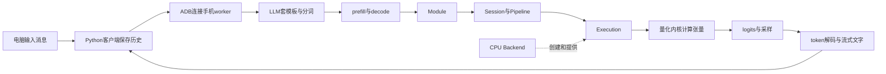

# 项目演示与主线讲解

项目可以这样介绍：**基于MNN的Android端侧推理运行时与执行计划优化。** 手机CPU负责计算，电脑负责输入、展示和采集；项目包含框架修改、聊天运行时、固定环境构建、限定数值与性能验证。这不是从零重写MNN，也还不是原生Android App。

## 演示先让人看到什么

先做[启动前检查](Android启动前检查与推理验收-20261016.md)，再在项目根目录启动已验运行包：

```powershell
python scripts/android/phone_chat.py --mode full --stats --prefill-plan-cache --plan-profile "build/source-runtime-bundle-20261016/手机运行包 空格/profile.json" --max-new-tokens 64
```

问一个简短问题，再追问，让观察者看到文字逐段出现、历史保留、统计更新；然后`/history`查看已确认消息，`/new`开始新对话，最后`/exit`正常退出。模型答得聪明与否不是这个演示的主要验收项；流式输出、消息顺序和资源释放才是对应工程能力。

想覆盖拒绝、短路径与计划复用，用[统一场景](Android请求拒绝与状态提交-20261016.md)的验收命令；它是自动场景驱动，不能把它说成互动终端的操作录屏。每次使用新输出目录，保留失败和未确认结果。

## 沿着这次请求解释框架



这是职责图，不表示每一个token只有一个算子。LLM决定何时计算输入和何时继续生成；Module封装模型调用；Session/Pipeline安排图中算子；Backend提供对应平台的Execution；Execution再组织张量、线程、缓冲区和内核。

可以用一句话回应“Pipeline是不是Backend后一步”：**Pipeline负责调度，Backend负责提供执行器，两者是协作关系。** 不能把Backend画成模型数据依次经过的一层网络。

对nano-vLLM已有基础的你，token化和prefill/decode不必重新学一遍。需要接上的部分是：高层的一次模型调用如何落到MNN的图执行，再落到CPU算子的具体实现。先把每层输入、输出和职责说清，再进入某一个量化算子即可。

## 选一个优化解释，不堆实验名

这一轮适合讲“非末块省输出层＋主干计划常驻”：长prefill按32token分块，中间块的任务是更新上下文状态；只有需要下一个token时才需要词表输出。于是把不需要的输出计算省掉，并复用已经准备好的主干执行计划。新输入的数据计算仍要做，计划命中不是直接复用答案，也不是本模式跨轮复用KV。

这里有三类不同结论：历史诊断版本的完整分数对照限定数值行为；去诊断版本的固定场景计时衡量组合成本；当前源码程序的生成与运行包验收证明交付链路。它们有衔接关系，但不能冒充同一份ELF上的同一次实验。详细范围见[九场景证据索引](Android正式验收范围与证据索引-20261016.md)。

## 展示结束时应说清的范围

已验设备为Mi11，模型为固定Qwen3-0.6B MNN资源，后端为CPU，固定chunk32、同步greedy路径。新源码运行包已有真实聊天回归，但尚未直接补新程序的完整logits、性能和RSS验收。旧实验中的组合省时不能直接贴到新程序上。

公开仓库提供源码、补丁、构建配方与精简证据，不含模型、原生程序和工具链。当前电脑的空目录构建和独立客户端运行已验，不等于另一台电脑从零全流程已经验收。上游PR是否合并，需要按实际状态单独说明。

学会的标志不是记住文件名，而是能回答：消息在哪里保存？KV与执行计划分别保存什么？谁安排算子，谁提供实现？一次拒绝是否提交历史？某个性能数字对应哪份程序与哪个场景？本材料已提供，理解待反馈。
