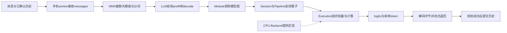

# 项目自学与独立演示手册

这份文档对应“学会自己解释项目并完成展示”。不要求按日期补看全部实验记录。已有C++与nano-vLLM基础的部分快速过，重点补上高层模型调用怎样进入MNN图执行，以及怎样说明本项目实际改动与证据。

工程已经完成，不等于你已经理解。以下各节目前均是“材料已提供，理解待自检”；能不用照抄、用自己的例子解释，再给自己标记理解。

## 先知道最终做出了什么

一句话：基于固定MNN版本，做了Android CPU小模型推理运行时、框架修复与执行路径改进，并把源码构建、手机验证和可选运行包接起来。

电脑负责输入、历史、展示与连接；手机CPU执行模型。现有固定环境是Mi11与Qwen3-0.6B MNN量化资源。它不是从零重写整个MNN，也没有原生APK或GPU/NPU实现。公开仓库分发代码、补丁、构建说明和精简证据，模型、工具链及程序二进制另外准备。

自检：别人问“计算究竟发生在哪里”，应能直接回答手机CPU，并指出电脑Python客户端与手机C++ worker各自负责什么。

## 第一遍：沿一次问题走完整条路

假设输入“你好，用一句话介绍你自己”。消息经过以下职责：



这是一张职责图，不是每次调用都逐个新建这些对象。启动阶段会加载、准备模型；后续请求复用活着的进程和适用执行对象。Backend参与准备及执行资源提供，不是模型数据依次流过的一层网络。

你应能用一分钟把图讲通；不用展开tokenizer原理或重复解释Transformer。先解释每层“接收什么、输出什么、负责什么”，再进入第二遍。

## 第二遍：补上MNN这一段

### LLM层：安排生成流程

输入是消息或token ID，职责是模板、分词、上下文及生成流程。prefill处理输入，decode继续生成；底层得到词表分数，采样出下一个token。项目使用的固定路径为同步greedy。输出通过token解码和流式回调返回，C++接口不一定直接return一整段字符串。

你熟悉nano-vLLM的prefill/decode即可快速衔接。这里要分清：LLM层安排何时调用模型，具体张量算子由下面的图执行层完成。

### Module层：把模型变成可调用的张量计算

Module提供一组输入张量到输出张量的调用边界。它是抽象调用边界，外层可能是组合模块；不能据此断言LLM每次直接调用的对象就是StaticModule。下面的StaticModule入口用来继续追到Session。LLM把当前需要计算的输入交给模型Module，再取回生成所需输出。不同模型的图输入可能还包含位置、mask或状态，不能把Module输入一律理解为原始文字或一个token整数。

### Session与Pipeline：准备和安排图中算子

模型图说明张量之间怎样依赖。Session承接一次模型执行所需状态，Pipeline组织算子的准备与执行顺序、内存和相关资源。它们处理的是张量与算子依赖，不是聊天角色或自然语言历史。

Backend提供平台能力，创建适用Execution并分配资源；Execution实现某个算子的实际执行准备和计算。两者是协作关系。因此“Pipeline是不是Backend的后一步”不是准确的理解方式。

### Execution与内核：真正计算张量

Execution负责把输入输出形状、布局、缓冲区和线程分工连接到具体计算。内核是更底层的循环、向量指令或专门计算函数。一次矩阵乘Execution可能先pack数据、选择分块与线程，再调用内核；不是整个Execution只有一句乘法。

先找一个实际CPU算子，认出准备阶段和执行阶段即可。不要第一遍就试图看懂所有SIMD汇编。看见onResize/onExecute时，优先判断这里在准备形状/资源，还是在计算数据；具体实现还要结合该算子的代码。

自检：一句“LLM调用模型”能否继续展开到Module、Session/Pipeline、Backend提供Execution、Execution调用内核，而不是直接从Python跳到汇编？

## 第三遍：分清四类状态，理解多轮与拒绝

| 状态 | 保存什么 | 解决什么问题 |
|---|---|---|
| 会话历史 | 已确认的用户消息和回答 | 下一轮语境是什么 |
| KV缓存 | 注意力已计算的K/V状态 | 在适用模式下少算已有前缀 |
| 执行计划 | 适用图怎样执行及相关准备 | 少做重复图准备 |
| mmap权重缓存 | 权重文件或派生产物 | 文件复用与资源生命周期 |

当前完整重算＋计划复用模式reuse_kv=false：每轮把已确认历史加新问题重新计算，计划命中不等于答案缓存或跨轮KV命中。

例如A/答A、B/答B已经完成，C太长被拒绝，随后问D。D的messages应含A/答A/B/答B/D，不含C。手机先套模板、分词得到真实长度，再做部署预算检查；拒绝不能提交历史。new则主动清历史，适用执行计划可继续保留。本轮“请简短总结”形成103个输入token，就是因为它带着前两轮和模板，不能按最后一句字数估计prefill长度。

参看[多轮状态课](Android多轮输入与拒绝后的状态-20261017.md)。你应能解释new、预算拒绝和计划释放各改变哪些状态。

## 第四遍：只选一个优化讲清楚

推荐讲“长prefill非末块省输出层＋复用主干执行计划”。输入按32token分块时，中间块仍要计算主体并更新上下文，但当时不需要词表输出分数；真正需要预测下一个token的末块才需要输出层。因此省掉非末块不需要的输出计算，再复用适用的主干执行准备。

这里有两个不同节省：少做部分输出计算，少做重复图准备。不是跳过整个Transformer，也不是复用上次回答。短输入只有一块，缺少可省的非末块，应该正常退回完整路径。

讲优化按这个顺序：原来多做了什么→为什么可以省→修改在哪层→哪些场景适用→怎样检查没有改变输出→性能结论对应哪份程序。

当前fresh程序已有固定生成和生命周期对照，没有它自己的完整logits或稳定提速承诺。历史诊断版本的分数验证、其他版本的计时和当前包的生成验证分开陈述。详细证据查[版本与范围索引](Android正式验收范围与证据索引-20261016.md)，不要背实验编号。

## 第五遍：量化与内核，掌握到什么程度

W4/W8首先说明权重用4/8bit表示，不自动决定激活类型。项目涉及的部分CPU路径会临时量化激活，用整数点积累加，再结合scale和必要偏移还原结果；也可能有其他数据类型路径，要看实际选中的内核。

点积需要累加，是因为一个输出依赖整条输入维度上各项乘积之和。例如输出通道o的值是sum_k x[k]*w[o,k]。分块计算时每块贡献一部分，最后仍要合起来。优化内层循环不保证整模型变快，因为pack、线程、访存及其他算子也有成本。

自检：能否区别权重量化、激活量化、整数累加与输出缩放；能否解释一次内核测试的收益为什么不能直接当作模型提速？不要求第一轮手写ARM汇编。

## 第六遍：选一个修复讲清楚

可讲CPU mmap缓存完整性：只见第一个缓存文件存在，不能证明整套缓存完整。修复用同步记录描述缓存文件数量和大小，复用前逐项校验；还要考虑异常、旧格式与共享组件的其他调用者。

共享分配器被CPU和Metal等调用，CPU引入新协议不能让未迁移调用者默默进入新语义。本项目后续明确区分协议选择和缓存信任状态，保留旧调用兼容，并做限定回归。讲到Metal时说明分配器级验证与真实Metal模型验证的区别，不能声称在没有Apple环境时验了GPU模型。

修复讲法：触发条件→旧行为为何错误→新不变量→共享调用者兼容→实际验证范围。PR是否合并另按上游实际状态说明，不作为项目可运行的替代证据。

## 自己做一次可复现演示

在项目根目录，手机ADB可用且固定模型已准备时：

```powershell
python scripts/android/phone_chat.py --mode full --stats --prefill-plan-cache --plan-profile "build/fresh-runtime-client-20261017/runtime/手机运行包 空格/profile.json" --max-new-tokens 64
```

1. 问“你好，用一句话介绍你自己”，观察流式文字。
2. 根据回答继续追问，执行/history看已确认消息，解释新输入为何包含历史。
3. 执行/new，再提短问题，说明历史清空与计划保留的区别。
4. 执行/exit正常退出。需要检查清理时看会话证据，不把终端返回提示符作为唯一证据。

这条命令使用本机已导出的固定包；公开仓库不附实际程序和模型，只有profile空壳不能启动。演示前用[快速开始](Android项目快速开始.md)核环境。不要为了展示吞吐随意增大上下文或同时启动多个手机会话；这些不在当前验收范围。

超预算与拒绝后继续可以展示已保存的自动验收记录；它是Session API场景，不能冒称手动终端录屏。8token或4token验证用于对比轨迹，不用于评价模型回答质量。

## 五分钟讲解顺序

- 第一分钟：项目目标、手机与电脑分工、固定环境和可运行入口。
- 第二分钟：沿一次请求解释LLM到图执行与算子，重点讲MNN职责。
- 第三分钟：一个优化，说明省什么、为什么可省、如何保证对应行为。
- 第四分钟：一个真实修复，说明完整性与共享调用兼容。
- 第五分钟：演示、证据和限制，说明哪些结论已经验证、哪些没有。

下面是表述参考，理解后换成自己的话，不要未经理解直接使用：

“项目基于固定MNN版本，面向Android CPU小模型推理。我做了手机常驻运行时和消息/预算/清理处理，参与CPU mmap缓存修复，并实现非末prefill块省输出层和执行计划复用。通过源码构建、新程序身份、固定手机生成对照和生命周期验证把交付接通。当前结论限定设备、模型、配置与程序版本；未承诺新程序稳定提速或其他设备适配。”

## 不看前文回答，再检查答案

1. 为什么模型输入长度不等于最后一句问题的长度？
2. Pipeline与Backend是什么关系？
3. Module与Execution各负责哪层事情？
4. new后计划命中，说明复用了什么、仍需计算什么？
5. 为什么非末prefill块能省输出层，短输入却不能照搬？
6. W4能否直接推出输入也是int4？
7. 为什么拒绝请求不能提交历史？
8. 新程序五题输出一样，是否证明所有输入的完整logits一样？
9. 为什么只看0.static存在不足以判断缓存可复用？
10. 当前还有哪些未验范围？

参考答案：1历史/角色模板也参与分词；2调度组织与平台实现协作，非顺序网络层；3模型级张量调用与算子级执行；4复用执行准备，数据仍重算；5中间块不需要当时的词表分数，单块必须产出分数；6不能，需看激活量化和实际内核；7否则下一题语境与预算被污染；8不能，生成序列仅覆盖特定输入与采样路径；9其他文件可能缺失或大小不对；10例如新电脑全流程、其他设备/模型、完整logits、稳定性能收益、APK/GPU/NPU，按具体范围区分。

给自己分三档：能复述词语；能解释具体例子；能指到源码并解释改动/证据。目标是后两档。某节不会就只补那节，不必回头读全部工程流水。

## 源码入口与后续复习

先读本手册的职责，再按下一节核对的真实源码入口逐个打开；不要一次打开几十个文件。学习路线以[学习台账](推理框架学习台账.md)为准，累计内容见[连续复习](项目自学与独立演示手册-20261017.md)。本文保存的是自学任务与资料，不把工程完成自动标记为学习者已掌握。

## 固定源码的八个导航入口

先打开本地构建准备记录（本地原件：`results/android/fresh-candidate-acceptance-20261016/build-v3/prepared.json`），其中`source_directory`是这份固定MNN源码的根目录；下表MNN文件路径都相对该目录。本项目worker仍从仓库自己的[phone_chat_plan_worker.cpp](../apps/android/phone_chat_plan_worker.cpp)打开。行号针对这次核对的固定源码，更新版本后应按函数名重新定位。

| 顺序 | 相对路径、函数与行号 | 这一站只需看懂什么 |
|---|---|---|
| 1. 请求入口（项目文件） | `apps/android/phone_chat_plan_worker.cpp`，`infer:72`，模板/分词`:83`，`response`调用`:89`；预算函数`budget:156` | messages经过预算检查后进入推理，流式文字怎样离开worker；该路径每题reset后完整重算消息。 |
| 2. LLM调用模型 | `transformers/llm/engine/src/llm.cpp`，`Llm::response(ChatMessages):1240`、`generate(input_ids):914`、`forwardRaw:550`，`Module::onForward`调用`:591` | 消息怎样进入生成流程；模型forward实际接收张量，而非原始聊天文字。此固定源码含本项目扩展，不应把新增行为全归给原生MNN。 |
| 3. 生成下一token | `transformers/llm/engine/src/speculative_decoding/generate.cpp`，`ArGeneration::generate:44`；采样`:63`，解码文字`:78`，流输出`:81`，单token forward`:88` | 已有logits先采样，输出文字，再为下一次采样计算logits。目录名虽然含speculative_decoding，ArGeneration仍是普通自回归，不说明当前启用了推测解码。 |
| 4. Module进入Session | `express/module/StaticModule.cpp`，`StaticModule::onForward:636`、`_execute:620`，`Session::run`调用`:628` | 形状准备与执行调用的边界。外层可能还有其他Module，不能把此表当作每个请求完整动态调用栈。 |
| 5. Session运行 | `source/core/Session.cpp`，`Session::run:245`，Pipeline调用`:251` | Session依次运行所持有的Pipeline，并传播错误；运行前要求形状准备完成。 |
| 6. Pipeline准备和执行 | `source/core/Pipeline.cpp`，`_createExecutions:538`、创建调用`:583`；`Pipeline::execute:1160`，`Execution::onExecute`调用`:1195` | 准备阶段创建算子执行对象，执行阶段按命令使用它们；不是每次计算都重新创建对象。 |
| 7. 平台工厂 | `source/core/OpCommonUtils.cpp`，`createExecutionWithExternal:666`，Backend调用`:669`；`source/backend/cpu/CPUBackend.cpp`，`CPUBackend::onCreate:767`，Creator调用`:795` | Pipeline经工具函数请求Backend选择具体Execution。Backend提供实现与资源，不是Pipeline之后的模型网络层。 |
| 8. 具体量化算子 | `source/backend/cpu/compute/ConvInt8TiledExecutor.cpp`，`DenseConvInt8TiledExecutor::onResize:935`、`onExecute:1863`；W4内核选择`:1177`、动态量化`:2000`、GEMM调用`:2295` | 认出选择内核、准备输入和调用计算的职责。W4权重不推出输入int4；此处存在动态量化激活路径。 |

这张表是静态源码导航，不保证每个请求、每一层都命中表中量化分支。要证明实际命中，需要相应配置与运行证据。`Execution`接口本身可在`source/core/Execution.hpp:45/55`查看`onResize/onExecute`，不用先深入全部派生类。

先尝试串起1→2→4→5→6→7→8，再回到3解释输出怎样继续生成。遇到工厂、封装或子模块时，关注它把任务交给谁，不必把每一个模板和辅助函数读完。
